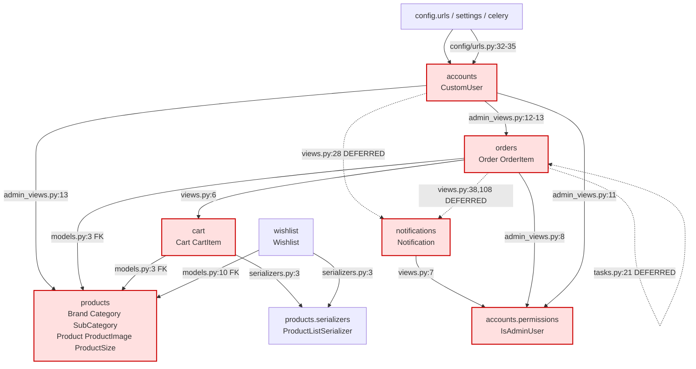
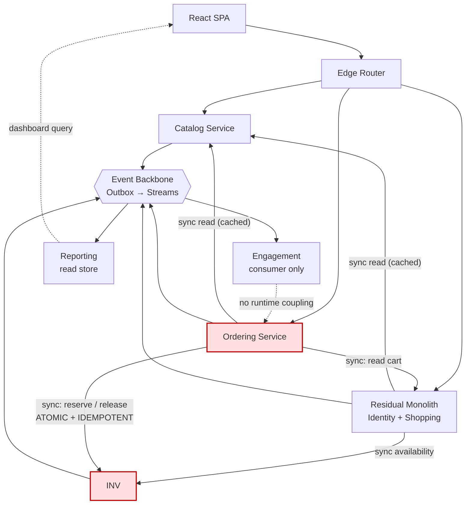

# Architecture Analysis — SneakIn E-Commerce Platform

**Purpose:** Establish the current-state architecture, derive the real business domains from the
codebase, define bounded contexts and data ownership, and propose a Strangler Fig migration plan
toward *selective* service extraction.

**Status:** Analysis only. No files were modified, no services created, no code refactored.

**Codebase:** `Sneak-in-ecommerce`, branch `architecture/microservices-migration` (level with `main`).
Backend: **2,732 LOC** of Python across 6 apps. Frontend: **4,053 LOC** of JSX.

---

## Executive Summary

The platform is a **Django 5.1 + DRF modular monolith**: 6 apps, 13 models, **one** PostgreSQL
database, **one** Redis instance, deployed as **one** Docker image running four process roles behind
container Nginx, on a single EC2 `t3.micro`.

Four findings drive everything that follows.

**1. Two of the seven real business domains are not Django apps.** `Inventory` exists only as three
columns on `Product`, mutated from four call sites in three different apps, with no entity, no
reservation concept, and no ledger. `Reporting` exists as cross-domain SQL inside the accounts admin
view plus a Celery task inside orders. Neither has an owner.

**2. `POST /api/orders/place/` spans four aggregates in one `@transaction.atomic`** (cart, order,
inventory, notification), and its stock check is a read-then-write **with no `select_for_update`**.
It is the hardest thing in the repository to extract and it has **zero tests**.

**3. Every app can read and write every table.** One schema, no routers, no per-app separation. The
boundaries proposed in this document are advisory only — nothing enforces them today.

**4. The catalog admin API destroys data in other domains.** `DELETE /api/admin/products/{id}/`
cascades into cart and wishlist rows and nulls order line items. This single handler is a hard
blocker for extracting Catalog, because the extracted service would have to write to databases it
must not own.

**Recommendation:** do **not** do one-service-per-Django-app. At this scale that produces a
distributed monolith with strictly more failure modes than the monolith has today. Execute the
7-phase plan in §11, extracting **3 real services** (Catalog, Ordering, Engagement-as-worker) plus
**one read store** (Reporting), while Identity and Shopping remain inside a residual monolith.
Target: **4 deployables + 1 worker**, not 7 services.

**Most valuable existing asset:** the OpenAPI schema at `/api/schema/` is machine-readable today.
Every strangler phase can verify contract parity against it automatically. Capture its baseline
before touching anything.

---

## Table of Contents

1. [Current Architecture](#1-current-architecture)
2. [Domain Map](#2-domain-map)
3. [Proposed Bounded Contexts](#3-proposed-bounded-contexts)
4. [Service Candidates](#4-service-candidates)
5. [Data Ownership](#5-data-ownership)
6. [Communication Patterns](#6-communication-patterns)
7. [Event Candidates](#7-event-candidates)
8. [Dependency Graph](#8-dependency-graph)
9. [Migration Risks](#9-migration-risks)
10. [Recommended Extraction Order](#10-recommended-extraction-order)
11. [Phase-by-Phase Migration Plan](#11-phase-by-phase-migration-plan)
12. [Appendix A — Endpoint Inventory](#appendix-a--endpoint-inventory)
13. [Appendix B — Evidence Index](#appendix-b--evidence-index)

---

## 1. Current Architecture

### 1.1 Runtime Topology

```
┌──────────────────────────┐
│  React 19 SPA (Vercel)   │   VITE_API_URL -> https://sneakin.duckdns.org/api
└────────────┬─────────────┘
             │ HTTPS
             ▼
┌──────────────────────────────────────────┐
│  Host Nginx  :443  (EC2)                 │  TLS termination
│  -> proxy_pass http://localhost:8080     │  container binds 8080 in prod
└────────────┬─────────────────────────────┘
             │ HTTP
             ▼
┌──────────────────────────────────────────┐
│  container Nginx  :80  (nginx/nginx.conf)│  /static, /media, /nginx-health
│  proxy_read_timeout 60s                  │  proxy_pass -> backend:8000
└────────────┬─────────────────────────────┘
             │ HTTP
             ▼
┌──────────────────────────────────────────┐
│  Gunicorn  0.0.0.0:8000                   │  sync workers = 2*CPU+1, preload_app
│  timeout 120s, max_requests 1000 (+50)    │  keepalive 5s, graceful 30s
└──────┬────────────────────┬──────────────┘
       │                    │
       ▼                    ▼
┌─────────────────┐   ┌────────────────────────┐
│ PostgreSQL 16   │   │  Redis 7                │
│ ONE database    │   │  db1 = Celery broker    │
│ ONE schema      │   │  db2 = result backend   │
│ no routers      │   │  no cache, no streams  │
└────────┬────────┘   └───────┬────────────────┘
         ▲                    │
         │                    │
┌────────┴────────────────────┴──────────────────────────────┐
│  celery_worker    celery_beat (DB scheduler)   flower     │
│  --concurrency=2, --max-memory-per-child=150000           │
│  ALL THREE built from the SAME backend/Dockerfile          │
└───────────────────────────────────────────────────────────┘
```

**Deployment:** single EC2 `t3.micro`. `docker-compose.yml` (7 services) + `docker-compose.prod.yml`
overrides. GitHub Actions CD (`cd.yml`): SSH to EC2 → `pg_dump` pre-deploy backup → `git pull` →
`docker compose build/up -d` → `migrate` → `collectstatic` → `docker image prune` → curl
`/api/health/` expecting 200, else fail the build.

### 1.2 Application Modules

| App | LOC | Responsibility | Models | Customer endpoints | Admin endpoints |
|---|---|---|---|---|---|
| `accounts` | 486 | Identity, auth, **admin dashboard**, **admin user mgmt**, **health check**, welcome email | `CustomUser` | 5 | 6 |
| `products` | 496 | Catalog **+ inventory stock** + admin product CRUD | `Brand`, `Category`, `SubCategory`, `Product`, `ProductImage`, `ProductSize` | 6 | 2 |
| `cart` | 291 | Shopping cart + user-creation signal | `Cart`, `CartItem` | 5 | — |
| `orders` | 483 | Checkout, order lifecycle, cancellation, **daily sales report task** | `Order`, `OrderItem` | 5 | 2 |
| `wishlist` | 90 | Saved products | `Wishlist` | 3 | — |
| `notifications` | 222 | In-app operator alerts | `Notification` | — | 4 |
| `config` | 350 | Settings, URLs, Celery, WSGI/ASGI, gunicorn | — | health/schema/docs | — |

Frontend: 20 pages, 15 components, 2 contexts, 4 admin pages.

### 1.3 Structural Observations

- **`config/urls.py:32-35` mounts four apps under `api/admin/`.** The admin API is assembled by URL
  `include()`, not owned by any domain. `accounts` owns the dashboard and user management,
  `products` owns product admin, `orders` owns order admin, `notifications` owns its own. **No
  module owns the admin surface.**
- **`apps/accounts/health_views.py`** — the system-wide health probe (`/api/health/`, the CD gate's
  success criterion) lives in the accounts app. Wrong home. After any split this becomes per-service
  readiness/liveness and the CD gate must fan out.
- **`config/asgi.py:9` sets `DJANGO_SETTINGS_MODULE=config.settings`, but
  `config/settings/__init__.py` is empty (0 bytes).** The ASGI entrypoint is dead code that would
  raise `ImportError`. WebSockets/async are unavailable.
- **`manage.py:8`, `config/wsgi.py:8`, `config/celery.py:5` all `setdefault` to
  `config.settings.dev`** — i.e. `DEBUG=True`, `ALLOWED_HOSTS=["*"]`, `CORS_ALLOW_ALL_ORIGINS=True`.
  Production correctness depends *entirely* on `DJANGO_SETTINGS_MODULE` being set in every
  container's env. `docker-compose.prod.yml` does this correctly — but the failure mode if it is
  ever missing is a **debug-mode production server, not a crash.**
- **`INSTALLED_APPS` is inconsistent:** `apps.cart.apps.CartConfig` and
  `apps.notifications.apps.NotificationsConfig` are referenced by class; `apps.accounts`,
  `apps.products`, `apps.orders`, `apps.wishlist` are bare strings.
- **Django admin is non-functional.** `admin.py` is an empty stub in accounts, products, orders,
  cart, and wishlist. Only `notifications/admin.py` registers a model. Yet `/admin/` is routed
  (`config/urls.py:8`), `is_staff`/`is_superuser` exist on the user model, and `seed_admin` creates
  an `is_superuser=True` admin. **A routed, credentialed, empty surface.** Remove it or build it
  deliberately.

### 1.4 Data Model & Relationships

```
                        CustomUser  (AUTH_USER_MODEL = "accounts.CustomUser")
                        email(unique) name phone address role is_active is_staff
                        is_superuser created_at   [AbstractBaseUser + PermissionsMixin]
                             │
      ┌──────────┬───────────┼────────────┬─────────────────┐
      │ OneToOne │ ForeignKey│ ForeignKey │  FK (nullable)  │
      │ cart     │ orders    │ wishlist   │  notifications  │
      ▼          ▼           ▼            ▼            (recipient=NULL => broadcast)
    Cart        Order      Wishlist   Notification
      │           │            │              │
      │ items     │ items      │ product     │ (no children)
      ▼           ▼            ▼
  CartItem ──┐ OrderItem  Wishlist ──┐
      │       │   │                  │
      │ FK product (CASCADE)         │
      │       │   └─ FK product (SET_NULL, nullable)
      │       │      snapshots: product_name, product_image, price, size, qty, cancelled
      │       │
      └───────┴──────────────────────┴──> Product
                                              │
        ┌────────────────────┬────────────────┼──────────────┬──────────────┐
        │                    │                │              │              │
     Brand              Category       SubCategory     ProductImage    ProductSize
   (CASCADE)            (CASCADE)        (CASCADE)       (CASCADE)      (CASCADE)
                                                                unique_together (product, size_value)

  Product columns, partitioned by business meaning:
    CATALOG     : name, description, release_date, bestseller, price, mrp
    INVENTORY   : stock, in_stock             <-- owned by nobody, written from 4 sites
    DEAD DATA   : ProductSize.stock          <-- seeded to hardcoded 5, NEVER read/written
```

#### Relational facts that drive extraction decisions

| # | Fact | Consequence |
|---|---|---|
| R1 | `Product` mixes catalog and inventory. `price`/`name`/`description`/`bestseller` are merchandising; `stock`/`in_stock` are supply-chain with a completely different write profile | The row must be split before Catalog and Inventory can be separate owners. See §5.2 |
| R2 | `OrderItem` **already carries price snapshots** (`product_name`, `product_image`, `price`; `orders/models.py:33-35`) | The most extraction-friendly decision in the repo. Orders are *nearly* already decoupled from live product reads. The residual `product` FK is used **only** for stock restoration |
| R3 | `OrderItem.cancelled` is **never written**. Both cancel paths (`orders/views.py:41-46`, `orders/admin_views.py:88-92`) set `Order.status` and restore stock for all items without touching the flag. `pages/Orders.jsx:42` comments "cancel only one item inside an order" | Dead column encoding an unbuilt feature; the two cancellation implementations can drift apart silently |
| R4 | Asymmetric deletes: `CartItem.product` and `Wishlist.product` are `CASCADE`; `OrderItem.product` is `SET_NULL` | `DELETE /api/admin/products/{id}/` (`products/admin_views.py:104`) destroys shopping data and mutates orders **from the catalog admin API**. Hard blocker for Catalog extraction (§9.1) |
| R5 | `Order.shipping_address` is a `TextField` holding `json.dumps()` output, defensively re-parsed in `orders/serializers.py:33-37` and `orders/admin_serializers.py:38-42` | No address schema, no validation, no address entity, two parse sites |
| R6 | Four models hold FKs to `AUTH_USER_MODEL` (`Cart`, `Order`, `Wishlist`, `Notification`) | Any identity extraction converts these to integer IDs + a local projection |
| R7 | `ProductFilter` filters `brand__name` / `category__name` / `subcategory__name` with `icontains` (`products/filters.py`) | Cross-table string matching. Cannot use FK IDs, and cannot be pushed to a foreign catalog service without a contract change |
| R8 | `unique_together` on `CartItem(cart,product,size)`, `Wishlist(user,product)`, `ProductSize(product,size_value)` | All local to their own table — these invariants **survive extraction cleanly.** Good news |

### 1.5 Authentication & Authorization

**Mechanism.** SimpleJWT, HS256, symmetric `SECRET_KEY`. Access 30 min, refresh 7 days,
`ROTATE_REFRESH_TOKENS=True`, `BLACKLIST_AFTER_ROTATION=True` backed by
`rest_framework_simplejwt.token_blacklist` (real DB tables: `OutstandingToken`, `BlacklistedToken`).

**Global DRF config** (`config/settings/base.py:60-79`):
- `DEFAULT_AUTHENTICATION_CLASSES = [JWTAuthentication]`
- `DEFAULT_PAGINATION_CLASS = PageNumberPagination`, `PAGE_SIZE = 12`
- `DEFAULT_FILTER_BACKENDS = [DjangoFilterBackend, SearchFilter, OrderingFilter]`
- `DEFAULT_THROTTLE_CLASSES = [AnonRateThrottle, UserRateThrottle]`, rates `anon: 30/min`,
  `user: 120/min`
- **`DEFAULT_PERMISSION_CLASSES` is absent** → DRF's implicit default is `AllowAny`

**Authorization model.** `CustomUser.role` is a plain `CharField` with choices `user`/`admin` — **not**
Django groups or permissions. Two hand-rolled classes in `apps/accounts/permissions.py`:

| Class | Logic | Usage |
|---|---|---|
| `IsAdminUser` | `request.user.role == "admin"` | Imported by `products/admin_views.py:8`, `orders/admin_views.py:8`, `notifications/views.py:7`, `accounts/admin_views.py:11` |
| `IsOwnerOrAdmin` | admin OR `obj == user` OR `obj.user == user` | **DEFINED BUT NEVER USED — dead code** |

**Four overlapping privilege signals** on one row: `role`, `is_active`, `is_staff`, `is_superuser`.
Only `role` is used for API authorization; `is_staff`/`is_superuser` exist to satisfy Django admin,
which is non-functional.

**Frontend.** `AuthContext.jsx:11-27` stores access + refresh in **`localStorage`**.
`isTokenExpired` decodes the JWT payload with `atob` (lines 31-38) with a 30s buffer. Silent refresh
via `POST /api/auth/token/refresh/`. Admin routing on `profile.role === "admin"` (client-side, UX
only).

**Concerns.**

- **C1 — No global default permission.** Every current view sets `permission_classes` explicitly, so
  there is **no live vulnerability today**. But every *new* view written from here on, in any new
  service, defaults to `AllowAny`. This is a latent security regression surface whose size grows
  with service count. Fix as a default-deny baseline in Phase 0.
- **C2 — `IsOwnerOrAdmin` unused**, so object-level authorization is enforced only by hand-written
  queryset filters (`Order.objects.filter(user=...)`, `CartItem.objects.filter(cart__user=...)`,
  `Wishlist.objects.filter(user=...)`). Correct today, but there is no declarative object-permission
  layer to inherit in a new service.
- **C3 — `SESSION_COOKIE_SAMESITE = "None"` and `CSRF_COOKIE_SAMESITE = "None"`** in
  `config/settings/prod.py:47-48`, justified in-code as "Required for cross-origin API". The API is
  pure `Authorization: Bearer` with no cookies. **Vestigial and over-broad** — widens CSRF exposure
  for zero benefit.
- **C4 — Identity owns authorization policy.** `role` lives on the user row, so any service asking
  "is this caller an admin" must either call Identity, cache claims in the JWT, or read a user table
  it does not own. The current JWT carries **no `role` claim**, so **every one of the 18 admin
  endpoints performs a DB read of the user row purely to authorize.**

### 1.6 Business Workflows

#### W1 — Checkout: `POST /api/orders/place/` — THE CRITICAL PATH

`apps/orders/views.py:50-116`, `PlaceOrderView.create`, wrapped in `@transaction.atomic`:

| Step | Line | Action | Aggregate touched |
|---|---|---|---|
| 1 | 53-58 | Load `Cart` with `prefetch_related("items__product")`; 404 if absent | Shopping |
| 2 | 60-63 | 400 if `not cart.items.exists()` | Shopping |
| 3 | 65-70 | **Validate** each item: `not in_stock or stock < quantity` → 400 | Inventory (**read**) |
| 4 | 72-73 | `serializer.is_valid(raise_exception=True)` | — |
| 5 | 75-77 | `total = Σ item.product.price × item.quantity` — reads **live** price | Catalog (**read**) |
| 6 | 79-84 | `Order.objects.create(...)`, `shipping_address=json.dumps(dict)` | Ordering |
| 7 | 86-100 | Per item: create `OrderItem` w/ snapshots; **`product.stock -= qty`**; flip `in_stock=False` at 0; `product.save()` | Inventory (**WRITE**) |
| 8 | 102 | `cart.items.all().delete()` | Shopping (**write**) |
| 9 | 105-111 | **Synchronous** `send_admin_notification(...)` insert | Engagement (**write**) |

**Four aggregates, one ACID transaction. This is the transaction that becomes hard after extraction.**

Two concrete defects:

- **D1 — Lost update / oversell.** Steps 3 and 7 are a read-then-write with **no
  `select_for_update()`** and no optimistic version column. Two concurrent checkouts for the last
  unit both pass validation and both decrement. `stock` is a `PositiveIntegerField`, so on
  PostgreSQL the resulting negative value raises `IntegrityError` **at commit** — the whole
  transaction rolls back and the customer receives a **500, not a clean rejection**. This is a live
  bug in the current monolith, not an extraction artifact. It has zero test coverage.
- **D2 — Notification inside the transaction.** Step 9 is a downstream side effect written as a
  local write. If `Notification.objects.create` fails, the entire order rolls back. **A failed alert
  must never lose a customer order.**

#### W2 — Order cancellation — DUPLICATED AND NON-IDEMPOTENT

Two independent implementations of the same business rule:

| Path | File:line | Guard | Restores stock | Sets `OrderItem.cancelled` | Sends notification |
|---|---|---|---|---|---|
| Customer | `orders/views.py:24-48` | `status not in [pending, confirmed]` → 400 | `stock += qty`, `in_stock = True` | **No** | Yes |
| Admin | `orders/admin_views.py:76-102` | `status in [delivered, cancelled]` → 400; validates target status | `stock += qty` **if `not item.cancelled`** | **No** | **No** |

- **D3 — drift risk.** The admin path has a *different* guard set (blocks `delivered`, not just
  `pending`/`confirmed`), a *different* restore condition (`not item.cancelled` — a flag never set),
  and sends no notification. Two copies of an inventory-compensating rule, no shared function, no
  idempotency key. After extraction this becomes two services independently reconciling stock.

#### W3 — Registration: `POST /api/auth/register/`

`accounts/views.py:14-40`: `serializer.save()` → `RefreshToken.for_user(user)` →
`send_welcome_email.delay(email, name)` (**async**) → `send_admin_notification(...)` (**synchronous
insert**). Returns user + token pair, 201.

#### W4 — Inventory mutation: four writers, no owner, no ledger

| # | Site | Operation |
|---|---|---|
| 1 | `orders/views.py:97-100` | decrement on checkout |
| 2 | `orders/views.py:44-48` | restore on customer cancel |
| 3 | `orders/admin_views.py:88-92` | restore on admin status → cancelled |
| 4 | `products/admin_views.py` (via `AdminProductWriteSerializer.update`) | arbitrary set of `stock`/`in_stock` |

No inventory entity, no reservation concept, no movement ledger, no audit trail, no idempotency key
on any adjustment. **The domain that most needs a boundary is the one with the least structure.**

#### W5 — Admin dashboard: `GET /api/admin/dashboard/`

`accounts/admin_views.py:25-82`. One HTTP request, one response, **four domains**:

- `User.objects.filter(role="user").count()` → Identity
- `Order.objects.count()` + `.filter(status=...).count()` ×3 → Ordering
- `Order.objects.filter(status="delivered").aggregate(Sum("total_amount"))` → Ordering
- `Product.objects.filter(stock__lt=10).count()` → **Inventory**
- `Order.objects.select_related("user").order_by("-created_at")[:10]` → Ordering JOIN Identity
- `OrderItem.objects.values("product_name").annotate(Sum("quantity"))[:5]` → Ordering

**A cross-domain read model with no owning domain.** It also carries a real N+1 sibling:
`AdminUserSerializer.get_orders_count` calls `obj.orders.count()` per user
(`accounts/admin_serializers.py:28-30`) — one COUNT query per row on the user-list endpoint. The
`hasattr(obj, "orders")` guard is always true (the `related_name` exists), so it always fires.

This endpoint is on the admin SPA's first paint (`admin/pages/Dashboard.jsx:18`), so any added
latency is felt immediately.

#### W6 — Daily sales report: Celery Beat cron `00:30` Asia/Kolkata

`orders/tasks.py`, scheduled in `settings/base.py:97-101`. Aggregates orders and order-items for
yesterday, formats a text report, `logger.info`s it, and
`send_mail(..., fail_silently=False)` to every active `role="admin"` user.

- **D4 — `fail_silently=False` on an SMTP call inside a scheduled task.** A Gmail outage raises, the
  Beat task fails, no report is produced. No retry, no dead-letter. Additionally: no
  `task_acks_late`, no idempotency → an overlapping re-run sends **duplicate emails**.

### 1.7 Background Jobs

| Task | Location | Trigger | Robustness |
|---|---|---|---|
| `send_welcome_email` | `accounts/tasks.py:11` | `.delay()` from `RegisterView` | `bind=True, max_retries=3, default_retry_delay=60`. **The only genuinely resilient job.** |
| `generate_daily_sales_report` | `orders/tasks.py:11` | Beat cron `00:30` | No retry, no timeout, no idempotency, `fail_silently=False`. See D4. |
| `debug_task` | `config/celery.py:17` | manual | dev only |

**Celery configuration gaps** (all absent today): `task_acks_late`, `task_reject_on_worker_lost`,
`worker_prefetch_multiplier`, per-task `time_limit`, dead-letter handling, `task_routes` queue
separation, and result consumption (the result backend is configured but **no result is ever
read**).

**Critically: Redis is used only as a Celery transport.** There is no event bus, no pub/sub, no
streams, no cache usage anywhere in the system. Every "event" is either a synchronous function call
or a Celery task with a hard-coded target. **There is no decoupling infrastructure to build on** —
which is why establishing one (Phase 1) is the prerequisite for everything after it.

### 1.8 External Integrations

| Integration | Where | Actual state |
|---|---|---|
| **SMTP (Gmail)** | `accounts/tasks.py:28`, `orders/tasks.py:76` | Real in prod; console backend in dev. See D4. |
| **Stripe / Razorpay** | `Order.PAYMENT_CHOICES` (`orders/models.py:14-18`) | **Declared but entirely unimplemented.** No SDK in `requirements/`, no gateway code, no webhook endpoint, no payment state on `Order`. `PlaceOrderSerializer` accepts `"stripe"`/`"razorpay"` and creates an order that looks paid but never charged anyone. The only functioning path is COD. |
| **Sentry** | `config/settings/base.py:100-107` | `sentry_sdk.init()` at settings-import time → **all four process roles** (web, worker, beat, flower) report to one project with no `environment`/`service` tag and no release. Cross-service attribution will be impossible without changing this. |
| **Prometheus** | `requirements/base.txt` | **Installed, never imported.** No `/metrics` endpoint, no middleware. |
| **Flower** | `docker-compose.prod.yml` | Bound to `127.0.0.1:5555`, basic auth, SSH-tunnel only. Reasonable. |
| **drf-spectacular** | `config/urls.py:11-25` | OpenAPI 3 at `/api/schema/`; Swagger UI + Redoc live. **The migration's most valuable asset.** |
| **Product imagery** | `ProductImage.image_url` | External URLs only; no upload path, no `ImageField`. `MEDIA_ROOT`, `/media/` and the nginx media block are dead weight; `pillow` is installed for nothing. |
| **Django admin** | 5 × empty `admin.py` stubs | Non-functional (§1.3). |

### 1.9 Configuration

**Layout.** `config/settings/{base,dev,prod}.py` via `python-decouple`. Production hardening is
genuine: HSTS 1yr + preload + subdomains, `X-Frame-Options: DENY`,
`SECURE_CONTENT_TYPE_NOSNIFF`, `SECURE_PROXY_SSL_HEADER`, `X-Forwarded-Host`, secure cookies, CORS
allow-list + `CORS_ALLOW_CREDENTIALS`, `CSRF_TRUSTED_ORIGINS`. The `SECURE_SSL_REDIRECT = False`
comment correctly explains the host-Nginx-terminates-TLS topology.

**What is missing, and matters far more at 6 services than at 1:**

| Missing | Why it blocks extraction |
|---|---|
| Per-service `DATABASES` / `DATABASE_ROUTERS` | No way to give a service its own schema, let alone its own instance |
| Request correlation ID middleware | Cannot trace a request across services, nor across the web→Celery `request_id` boundary |
| Configured HTTP retry / timeout policy | Cross-service calls with no timeout exhaust the Gunicorn thread pool (`timeout 120s`) |
| Circuit breaker | No protection against a downstream service being *slow* rather than *down* |
| **API versioning (`/api/v1/`)** | **Strangler requires serving the monolith and the new service at the same public path simultaneously.** Without a version dimension you cannot route one URL to two implementations. This is the single hardest prerequisite. |
| Feature flags | Cannot shift traffic gradually between monolith and service |
| Per-service observability config | Sentry untagged, no metrics endpoint, no structured logging fields |

`.env.example` / `.env.prod.example` are well documented. Verify `.gitignore` excludes `.env` and
`.env.prod`.

### 1.10 Tests

| Area | Location | Cases | Assessment |
|---|---|---|---|
| Cart API | `cart/tests/test_cart_api.py` | 8 | Best-tested module. `APITestCase` + `force_authenticate`. Covers add, increment, update, remove, clear, 401, out-of-stock. |
| Admin users + dashboard | `accounts/tests/test_admin_views.py` | 12 | Strong authorization coverage, including the 401-vs-403 distinction. |
| Admin products | `products/tests/test_admin_views.py` | 7 | Good CRUD + 403/404 coverage. |
| Admin orders | `orders/tests/test_admin_views.py` | 6 | `test_filter_by_status` asserts on `response.data['results']` while `test_admin_can_list_orders` asserts `len(response.data) >= 1` — on a **paginated dict** that counts keys, not orders. Both pass without actually asserting anything about orders. |
| Notifications | `notifications/tests/test_views.py` | 4 | Basic list / read / unread-count. |
| Accounts tasks | `accounts/tests/test_tasks.py` | 1 | Calls `send_welcome_email(...)` **synchronously**, never `.delay()`. The `except → self.retry` branch is uncovered. |
| **Wishlist** | `wishlist/tests.py` | **0** | Empty stub. **Zero tests.** |
| **`PlaceOrderView`** | — | **0** | **The highest-risk code in the repository is entirely untested.** |
| **Customer orders API** | — | **0** | `OrderViewSet` list/retrieve/cancel untested. |
| **Products customer API** | — | **0** | Filters, search, ordering, `bestsellers`, pagination untested. |
| **Cart → Order integration** | — | **0** | The checkout transaction is untested. |
| **Concurrency / oversell** | — | **0** | Defect D1 is invisible to the suite. |
| **Migration drift** | — | **0** | No `makemigrations --check` in CI; model/migration divergence ships silently. |

**Total: 38 cases** across 6 files, for 2,732 LOC of backend code. CI runs
`pytest --cov=apps --cov-report=term-missing` with **no coverage threshold enforced**.

`conftest.py` is itself a coupling artifact: lines 5-6 import `apps.products.models` **and**
`apps.orders.models`, so the fixture graph spans two domains for every test module
(`sample_order` → `sample_product` → `sample_brand`/`sample_category`/`sample_subcategory`).
**The test suite encodes exactly the coupling the production code has.** `factory-boy==3.3.1` is
installed but never used.

### 1.11 Docker & Deployment

- `backend/Dockerfile`: 2-stage (`python:3.12-slim` builder with `gcc libpq-dev` → runtime with
  `libpq5` only), non-root `appuser:appgroup`, `PYTHONDONTWRITEBYTECODE=1`, `collectstatic` at build.
- **One image, four roles.** `backend`, `celery_worker`, `celery_beat`, `flower` all
  `build: ./backend` with a different `command:`. No per-service build targets, no role-specific
  dependency trimming.
- **No `healthcheck` on the `backend` service** (only `db` and `redis` have them). The CD gate curls
  the *host* URL, so a wedged-but-listening Gunicorn passes.
- **No `deploy.resources` limits**; no health-conditioned `depends_on` for the Celery roles.
- **Hard-cutover deploys.** `docker compose up -d` replaces containers in place. No blue/green, no
  rolling, no leader election, no migration rollback. A bad migration bricks the app. The CD backup
  is a host-side `pg_dump` pruned to 7 retained copies by `tail -n +8`.
- A single EC2 host is a single point of failure for every service at once. Once services are
  separate they will still share one host — so **the first honest limit of this migration is the
  host, not the code.**

### 1.12 Actual Inter-Module Dependencies

Derived from import analysis over `backend/apps/**` and `backend/config/**`, excluding migrations.
Test-only coupling is listed last.

| From | To | Symbol | Line | Kind |
|---|---|---|---|---|
| `accounts.admin_views` | `orders.models` | `Order`, `OrderItem` | 12 | **hard import** — dashboard revenue, top products |
| `accounts.admin_views` | `products.models` | `Product` | 13 | **hard import** — low-stock count |
| `accounts.admin_views` | `accounts.permissions` | `IsAdminUser` | 11 | hard import |
| `accounts.views` | `notifications.utils` | `send_admin_notification` | 28 | **function-local import** (deferred) |
| `orders.views` | `cart.models` | `Cart` | 6 | **hard import** — checkout reads cart |
| `orders.views` | `notifications.utils` | `send_admin_notification` | 38, 108 | **function-local import** (deferred) ×2 |
| `orders.models` | `products.models` | `Product` | 3 | **hard FK** — `OrderItem.product` |
| `orders.admin_views` | `accounts.permissions` | `IsAdminUser` | 8 | hard import |
| `orders.tasks` | `orders.models` | `Order`, `OrderItem` | 21 | **function-local import** (deferred) |
| `cart.models` | `products.models` | `Product` | 3 | **hard FK** — `CartItem.product` |
| `cart.serializers` | `products.serializers` | `ProductListSerializer` | 3 | hard import — nested serialization |
| `cart.views` | `products.models` | `Product` | 6 | hard import — stock check |
| `cart.signals` | `AUTH_USER_MODEL` | `post_save` receiver | 6-10 | **cross-app signal** via `CartConfig.ready()` |
| `wishlist.models` | `products.models` | `"products.Product"` | 10 | **hard FK** (string ref) |
| `wishlist.serializers` | `products.serializers` | `ProductListSerializer` | 3 | hard import |
| `products.admin_views` | `accounts.permissions` | `IsAdminUser` | 8 | hard import |
| `notifications.views` | `accounts.permissions` | `IsAdminUser` | 7 | hard import |
| `config.urls` | `accounts.health_views` | `HealthCheckAPIView` | 5 | hard import |
| `conftest` *(test only)* | `products.models` + `orders.models` | 6 models | 5-6 | fixture-level coupling |

#### Circular dependencies — real, not stylistic

**Cycle 1 — `accounts` ⇄ `notifications`**

```
accounts/views.py:28       -->  notifications/utils.py
notifications/views.py:7   -->  accounts/permissions.py   -->  (leaf, no imports)
```

`accounts` and `notifications` are mutually dependent. The cycle is **defused, not designed away**,
by a function-local import at `accounts/views.py:28`. That is a latent `ImportError` at module load
waiting for any refactor that hoists that import to file scope. The same deferral appears at
`orders/views.py:38` and `:108`.

**Cycle 2 — `accounts` → `orders` → `cart` → `products` → `accounts`**

```
accounts/admin_views.py:12  -->  orders/models.py:3  -->  products/models.py:3
orders/views.py:6           -->  cart/models.py:3  ---+
                                              (closed by)
products/admin_views.py:8   -->  accounts/permissions.py
orders/admin_views.py:8     -->  accounts/permissions.py
```

Only the leaf-ness of `permissions.py` prevents an actual `ImportError` today.

**Cycle 3 — `orders.views` ⇄ `orders.tasks`**

`orders/tasks.py:21` defers `from apps.orders.models import ...` into the function body specifically
to avoid loading the order model at task-registration time.

**Consequence for migration:** `accounts` cannot be extracted first — it sits at the centre of three
cycles and holds the `AUTH_USER_MODEL` that four models FK against. This is why Identity is last in
the recommended order (§10), and it is a fact derivable from the import graph rather than a
stylistic preference.

---

## 2. Domain Map

Domains are derived from **business capability and change driver**, not from Django app labels.

| # | Domain | Ubiquitous language | Change driver | Current home | Boundary health |
|---|---|---|---|---|---|
| **D1** | **Identity & Access** | user, role, credential, token, profile | Security policy, auth protocol, authn provider | `accounts` | **Poor** — owns `AUTH_USER_MODEL` targeted by 4 FKs, and sits inside 3 import cycles |
| **D2** | **Product Catalog** | product, brand, category, subcategory, image, price, bestseller | Merchandising, SEO, content, pricing strategy | `products` (partial) | **Good** — read-mostly, clean public API, single writer (admin endpoint) |
| **D3** | **Inventory** | stock, available, reserved, in_stock, low-stock, size stock | Supply chain, warehousing, replenishment, ops | **NOT AN APP** — 3 columns on `Product` | **Worst** — 4 write sites in 3 apps, no entity, no ledger, no reservations, no owner |
| **D4** | **Shopping** | cart, cart item, wishlist, quantity, size selection | Conversion UX only | `cart` + `wishlist` | **Adequate** — 381 LOC, 3 tables, user-scoped, no business rules beyond totals |
| **D5** | **Ordering & Fulfilment** | order, order item, status, cancellation, total, shipping address | Revenue, logistics, returns, tax | `orders` | **Poor** — the checkout transaction spans 4 aggregates; cancellation logic duplicated |
| **D6** | **Engagement / Operator Alerting** | notification, broadcast, read state, alert type | Operator workflow, on-call routing | `notifications` | **Good in shape, bad in wiring** — pure downstream, yet called *synchronously from inside transactions* |
| **D7** | **Reporting & Analytics** | revenue, top products, daily sales, dashboard rollup | Decision support, exec reporting | **NOT AN APP** — smeared across 2 apps | **Worst** — no owning domain; cross-domain SQL in an HTTP handler and a Celery task |

### 2.1 The two non-app domains

> **D3 Inventory is not a module. It is three columns on `Product` mutated from four call sites in
> three different apps, with no entity, no reservation concept, and no movement ledger.** It has the
> highest write frequency in the system and the lowest ownership. Worse, `ProductSize.stock` is
> seeded to a hardcoded `5` (`seed_products.py:50`), never read, never written — so there are *two*
> competing stock models and **neither is authoritative**.

> **D7 Reporting is not a module. It is cross-domain SQL inside the accounts admin view
> (`AdminDashboardAPIView`, 4 domains in one request) and a Celery task inside orders
> (`generate_daily_sales_report`, 2 domains plus an SMTP call).** It is a read model wearing the
> costume of a feature. In a service world reporting must never be a synchronous dependency of
> anything — and today the admin dashboard *is* a hard synchronous dependency of the React admin
> app's first paint (`admin/pages/Dashboard.jsx:18`).

### 2.2 Domain-to-endpoint map

| Domain | Endpoints that serve it | Endpoints that merely *touch* it |
|---|---|---|
| D1 Identity | `POST /api/auth/{register,login,token/refresh,logout}/`, `GET\|PATCH /api/auth/profile/`, `GET\|PATCH\|DELETE /api/admin/users/*` | every authenticated endpoint (FK read); all 18 admin endpoints (role check) |
| D2 Catalog | `GET /api/products/*`, `GET /api/{brands,categories,subcategories}/`, `GET\|POST\|PATCH\|DELETE /api/admin/products/*` | `POST /api/cart/add/` (stock check), `GET /api/cart/`, wishlist list, `POST /api/orders/place/` (price), `GET /api/admin/dashboard/` (low stock) |
| D3 Inventory | **NONE** | `POST /api/cart/add/`, `POST /api/orders/place/`, `PATCH /api/orders/{id}/cancel/`, `PATCH /api/admin/orders/{id}/`, `PATCH /api/admin/products/{id}/`, `GET /api/admin/dashboard/` |
| D4 Shopping | `GET /api/cart/`, `POST /api/cart/add/`, `PATCH\|DELETE /api/cart/item/*`, `DELETE /api/cart/clear/`, `GET\|POST\|DELETE /api/wishlist/*` | `POST /api/orders/place/` (reads + clears) |
| D5 Ordering | `POST /api/orders/place/`, `GET /api/orders/`, `GET /api/orders/{id}/`, `PATCH /api/orders/{id}/cancel/`, `GET\|PATCH /api/admin/orders/*` | `GET /api/admin/dashboard/` |
| D6 Engagement | `GET /api/admin/notifications/`, `PATCH /api/admin/notifications/{id}/read/`, `PATCH /api/admin/notifications/read-all/`, `GET /api/admin/notifications/unread-count/` | `POST /api/auth/register/`, `POST /api/orders/place/`, `PATCH /api/orders/{id}/cancel/` — all three **synchronously** |
| D7 Reporting | `GET /api/admin/dashboard/` | daily email report (Celery, no API) |

**The asymmetry is the migration's core insight:** D3 (Inventory) has **zero endpoints of its own**
yet is written by four different endpoints. D6 (Engagement) is written **synchronously** by three
endpoints in three different apps. Both are unowned.

---

## 3. Proposed Bounded Contexts

| Context | Responsibility | Models owned | Data owned | APIs exposed | Sync deps | Async events in / out | Upstream | Downstream |
|---|---|---|---|---|---|---|---|---|
| **Identity & Access** | Credentials, roles, token issue/refresh/revoke, profile, admin user lifecycle | `CustomUser` | `identity` | `/auth/register`, `/auth/login`, `/auth/token/refresh`, `/auth/logout`, `/auth/profile`, `/admin/users/*` | none | **in:** — **out:** `user.registered`, `user.role_changed`, `user.deactivated` | — | every authenticated domain |
| **Catalog** | Product definition, taxonomy, imagery, published price, merchandising flags | `Brand`, `Category`, `SubCategory`, `Product` *(minus stock)*, `ProductImage` | `catalog` | `/products*`, `/brands`, `/categories`, `/subcategories`, `/admin/products*` | Inventory (availability projection, async-fed) | **in:** `inventory.updated` **out:** `product.created/updated/deleted`, `price.changed`, `product.availability_changed` | — | Shopping, Ordering, Reporting |
| **Inventory** | Available/reserved quantities per (product, size); reservations; releases; low-stock thresholds; movement ledger | **new:** `StockLevel`, `Reservation`, `StockMovement` — absorbs `Product.stock`, `Product.in_stock`, `ProductSize.stock` | `inventory` | `/inventory/availability` (batch, internal), `/admin/inventory/*` | Catalog (validate product exists) | **in:** `order.placed`, `order.cancelled` **out:** `inventory.reserved`, `inventory.released`, `inventory.depleted`, `inventory.low_stock` | Ordering | Shopping, Catalog, Engagement |
| **Shopping** | Cart + wishlist aggregates for one user; totals; size selection | `Cart`, `CartItem`, `Wishlist` | `shopping` | `/cart*`, `/wishlist*` | Catalog (read), Inventory (availability) | **in:** `price.changed`, `product.deleted` **out:** `cart.updated`, `cart.abandoned` | Catalog, Inventory | Ordering |
| **Ordering & Fulfilment** | Order aggregate, line items with price snapshots, lifecycle state machine, checkout orchestration, cancellation | `Order`, `OrderItem` *(`product` FK → `product_id` int)*, **new** `OrderStatusHistory` | `ordering` | `/orders*`, `/admin/orders/*` | Catalog (read at compose), Identity (read) | **in:** `inventory.reserve_failed` **out:** `order.placed`, `order.cancelled`, `order.status_changed` | Shopping, Catalog, Inventory | Inventory, Engagement, Reporting |
| **Engagement** | Consume domain events, render operator alerts, own read/unread state | `Notification` *(`recipient` FK → `recipient_user_id` int)* | `engagement` | `/admin/notifications*` **read-only** | none | **in:** `order.*`, `user.*`, `inventory.*` **out:** none | all | none (terminal) |
| **Reporting** | Materialized read models for dashboard + sales reporting; **never** a runtime dependency | **new:** `DailySalesFact`, `DashboardRollup` | `reporting` | `/admin/dashboard`, `/admin/reports/sales` **read-only** | none | **in:** all of the above **out:** none | all | none (terminal) |

### 3.1 Consistency requirements

| Workflow | Requirement | Mechanism today | Required after extraction |
|---|---|---|---|
| **Stock check → decrement** | **Strong. Zero oversell, zero negative stock.** | One DB transaction, but **no `select_for_update`**, no version column (D1) | Saga. `inventory.reserve` **must** be a single-owner, atomic, row-locked operation. Orders must **never** decrement inventory directly. |
| **Order + cart + inventory atomicity** | Strong at inventory; **eventual** at order and cart | One `@transaction.atomic` across 4 aggregates | Orchestrated saga with compensations: `reserve` fails → no order; order created but cart-clear fails → idempotent retry; `reserve` succeeded but order write failed → `inventory.release` compensating command |
| **Cancellation stock restoration** | **Exactly-once** | Duplicated in 2 files, no idempotency key, gated only by a status flag (D3) | `inventory.release` keyed on `(order_id, order_item_id)` — idempotent by construction, single implementation |
| **Registration** | Strong for the user row; eventual for email + alert | Email async, alert synchronous-in-tx | Fully async: `user.registered` → two independent consumers |
| **Dashboard aggregates** | Eventual; seconds-to-minutes lag acceptable | Synchronous cross-domain SQL in the request path | Read store fed by events; UI must display a `generated_at` timestamp |
| **Catalog read-after-write (admin)** | **Strong** — an admin must see their own edit | Single DB | Eventual by default (~seconds). Acceptable for the storefront, **NOT acceptable for the admin edit form.** Needs read-your-writes via a local write-through cache or a synchronous read-back on the Catalog service. Must be called out in the SPA. |
| **Cart totals** | Strong within one cart | Single DB; `CartSerializer.get_total` re-reads `obj.items` and re-derives price from the live Product row | Shopping owns its DB; **price must be snapshotted into `CartItem` at add-time** or totals drift from Catalog price changes. Required change — see §9.7. |

### 3.2 Failure scenarios per context

| Context | Fails how | Blast radius today | Blast radius after extraction | Required degradation |
|---|---|---|---|---|
| **Identity** | Cannot issue/validate tokens | **Total outage** — nothing works | Same, but now only Identity must stay up; others serve public reads | Highest availability mandate. This is why it is last, or never. |
| **Catalog** | Cannot serve product reads | **Total browse outage** | Independent failure domain — a *benefit*. Browsing + checkout both degrade. | Serve from edge cache. Stale catalog is acceptable; stale inventory is not. |
| **Inventory** | Cannot reserve/release | n/a (same DB) | **Checkout fails hard.** Browsing continues. | **New failure mode the monolith does not have.** Must be explicit: 503, cart left intact, no partial order. Requires a circuit breaker. |
| **Shopping** | Cannot read/write cart | n/a | Browsing, wishlist, product pages keep working; checkout unavailable | Lowest criticality, easiest to tolerate |
| **Ordering** | Cannot write orders | n/a | **Checkout fails. This must be the MOST available service, not the least.** | Design the write path for availability over consistency |
| **Engagement** | Consumer lag or crash | Admin sees stale alerts (invisible) | **Must not affect checkout.** This is the entire point of extracting it first. | Queue buffers; alerts catch up. Zero runtime coupling. |
| **Reporting** | Rollup stale or missing | n/a | Admin dashboard shows stale data | Degrade to "last generated at T", never error |

**Critical insight for Phase 1:** Engagement and Reporting are the **only** two contexts that can be
extracted with provably zero impact on the checkout path. That is exactly why they go first — they
build and validate the event backbone every later extraction depends on, at essentially zero risk.

---

## 4. Service Candidates

The instruction to *not* assume every domain should become a service is taken literally.

### 4.1 Strong service candidates

| Service | Justification | Extraction risk | Confidence |
|---|---|---|---|
| **Catalog** | Highest read volume and fully public → cacheable and horizontally scalable on its own. Zero write coupling except inventory. Clean 6-endpoint read-only customer surface. Single admin writer. Can shed DOM-heavy storefront traffic without touching checkout. | **Medium-High** — blocked by the cross-domain `DELETE /api/admin/products/{id}/` cascade (R4). Fixable in Phase 0. | **High** |
| **Ordering** | Owns the transaction that *must* change. Isolating it makes the checkout saga explicit, testable, independently deployable. Highest business value, so it deserves isolation. Only place with real consistency requirements worth engineering. | **High** — the saga is genuinely hard, and the code has **zero tests** today. | **High** value / **Medium** risk |
| **Engagement** *(worker, not a service)* | Pure downstream, zero sync dependencies, zero business logic. Extracting it proves the event backbone, removes three synchronous writes from transactional code paths (**fixes D2**), and breaking it is harmless. The ideal Strangler first move. | **Very low** | **Very high** |
| **Reporting** *(read store)* | Must leave the request path of every other service. A materialized read store is the only correct shape; a synchronously-called "reporting service" is strictly worse. | **Low** (after Engagement proves the backbone) | **High** |

### 4.2 Should remain modules — explicitly NOT services

| Context | Why it must not become a service |
|---|---|
| **Wishlist + Cart → one "Shopping" service** | **381 LOC, 3 tables, 8 endpoints.** Both are user-scoped collections of product references with an identical shape (`product_id`, `size`, `quantity`). Separating them adds a network hop and a serialization boundary for **zero** independent scaling, deployment, or team benefit. Textbook over-decomposition. **Keep them together.** |
| **Identity & Access** | Smallest code (486 LOC, 1 model), **largest blast radius (100%)**, sits inside 3 import cycles, and is the FK target of 4 models. Extracting converts those FKs into joins or replicated projections and forces a token-introspection decision with no payoff for a single frontend client. **Cost high, benefit nil.** Keep as a module; revisit only when a second consumer (native mobile, partner API) appears. |
| **Reporting as a synchronous service** | A dashboard that calls a "reporting service" over HTTP is strictly worse than a read store — it adds a hop to the exact query that most needs to be fast and least needs strong consistency. Model as event-fed read store + query API. |
| **Brand / Category / SubCategory** | 40 LOC of pure reference data, single writer, no independent lifecycle, no independent release cadence. Extracting them from `Product` creates a distributed join to render a product card. **Strictly negative.** |
| **ProductImage** | No lifecycle independence from Product whatsoever. |
| **ProductSize** | Its `stock` column is dead data. Delete it, or fold it into Inventory as part of `StockLevel`. Never its own thing. |
| **Django admin** | Non-functional (5 of 6 `admin.py` files are empty stubs). Delete it, or rebuild deliberately per service. Do not migrate a surface that does not work. |

### 4.3 Recommended target topology

```
                          ┌──────────────────────────────────────────┐
   React SPA ────────────▶│  EDGE ROUTER  (host Nginx)              │
   (Vercel)               │  /api/auth/**           -> monolith      │
                          │  /api/cart/**           -> monolith      │
                          │  /api/wishlist/**       -> monolith      │
                          │  /api/products/**       -> catalog-svc   (Phase 3)
                          │  /api/orders/**         -> ordering-svc  (Phase 6)
                          │  /api/admin/dashboard/**-> reporting-svc (Phase 2)
                          └────────────────┬─────────────────────────┘
                                           │
        ┌──────────────────────────────────┼────────────────────────────┐
        │                                  │                            │
        ▼                                  ▼                            ▼
┌────────────────┐            ┌──────────────────────┐      ┌────────────────────────┐
│ catalog-svc    │            │  ordering-svc        │      │  monolith (residual)   │
│ Django + DRF   │  reads    │  Django + DRF        │      │  identity, shopping,   │
│ owns `catalog` │◀───────────│  owns `ordering`     │      │  welcome-email task    │
│ + Redis cache  │ (sync,     │  owns `inventory`    │      │  owns `identity`,      │
│ read-mostly    │  cached)   │  (from Phase 5)      │      │  `shopping`            │
└────────┬───────┘            └──────────┬───────────┘      └───────────┬────────────┘
         │                               │                              │
         └───────────────┬───────────────┘                              │
                         ▼                                              │
          ┌──────────────────────────────────────────────────┐          │
          │  EVENT BACKBONE: transactional outbox → Streams  │◀─────────┘
          └────┬──────────────────────────────┬──────────────┘
               │                              │              │
               ▼                              ▼              ▼
    ┌──────────────────┐        ┌────────────────────┐  ┌──────────────────┐
    │ engagement-svc   │        │  reporting-svc     │  │ (future          │
    │ CONSUMER ONLY    │        │  read store        │  │  consumers:      │
    │ owns             │        │  owns              │  │  search index,   │
    │ `engagement`     │        │  `reporting`       │  │  analytics,      │
    │ NO public writes │        │  read-only API     │  │  campaigns)      │
    └──────────────────┘        └────────────────────┘  └──────────────────┘
```

**Target: 4 deployables + 2 workers.** Not 7 services.

At `t3.micro` scale with `celery_worker --concurrency=2`, this is already close to the upper bound of
what one operator can run and observe. Every additional service must justify itself against that
constraint.

---

## 5. Data Ownership

### 5.1 Target ownership map

| Table / column group | Owner today | Owner target | Migration mechanism | Notes |
|---|---|---|---|---|
| `accounts_customuser` | accounts | **Identity** (stays monolith) | Never split from credentials | |
| `products_brand` | products | Catalog | Straight move | 1 writer, no lifecycle |
| `products_category` | products | Catalog | Straight move | |
| `products_subcategory` | products | Catalog | Straight move | |
| `products_product` *(catalog cols)* | products | **Catalog** | Column split (§5.2) | |
| `products_product.stock`, `.in_stock` | products | **Inventory** | Column split, then table move | 4 current writers (§1.6 W4) |
| `products_productsize` | products | **Inventory** (or delete) | Backfill + move, or drop | `stock` is dead data |
| `products_productimage` | products | Catalog | Straight move | |
| `cart_cart` | cart | **Shopping** (stays monolith) | Not extracted | |
| `cart_cartitem` | cart | **Shopping** (stays monolith) | Not extracted | `product` FK stays; Shopping consumes Catalog |
| `wishlist_wishlist` | wishlist | **Shopping** (stays monolith) | Not extracted | Merge with cart into one deployable |
| `orders_order` | orders | **Ordering** | Straight move | |
| `orders_orderitem` | orders | **Ordering** | Straight move; `product_id` → plain int | Drop FK; snapshots already present (R2) |
| *(new)* `orderstatushistory` | — | Ordering | New | Fixes R3 — makes lifecycle auditable |
| `notifications_notification` | notifications | Engagement | Straight move; `recipient` FK → `recipient_user_id` int | |
| *(new)* `stocklevel`, `reservation`, `stockmovement` | — | Inventory | New | Absorbs `Product.stock`/`in_stock`/`ProductSize.stock` |
| *(new)* `dailysalesfact`, `dashboardrollup` | — | Reporting | New | Fed by events; the admin dashboard becomes a pure read |

### 5.2 The column-level split problem

Catalog and Inventory share **one row** (`Product`). Any clean split requires one of:

**Option A — column-level ownership, one table.** Catalog keeps `products_product`; Inventory writes
`stock`/`in_stock` through a single dedicated accessor owned by the Inventory service. Technically a
shared table, which is a distributed-monolith smell. **Acceptable only as a transitional state**,
and only if the rule "no Catalog code ever touches stock" is mechanically enforced (lint/import
boundary).

**Option B — full table split (recommended).** Inventory owns a new `inventory_stocklevel` table
keyed by `(product_id, size_value | NULL)`. Catalog's `Product` loses `stock` and `in_stock`.
Migration: backfill from `products_product` (reconcile the size rows first — they were seeded with a
hardcoded `5`, §2.1) → dual-write → flip reads → drop columns.
Every current `product.in_stock` consumer must switch to an Inventory lookup:
`POST /api/cart/add/` (availability gate), `GET /api/products/` (the `in_stock` filter in
`ProductFilter` and the `in_stock` field in `ProductListSerializer`), and
`GET /api/admin/dashboard/` (low-stock count).

Option B is more work. It is the only one that survives review, because Option A means Catalog's
database physically contains Inventory's authoritative data and a single mis-written query breaks the
invariant.

> **Design consequence:** `in_stock` is currently a *stored* boolean derived from `stock`, exposed
> directly in the public product list serializer. After Option B, `in_stock` becomes a **derived
> projection** fed by `inventory.updated` events. The public API contract can stay identical — which
> is the point. Consumers of `in_stock` are performing a cache read, not an availability guarantee.
> Any code that treats `in_stock == true` as "I can buy this" is relying on a lie that gets more
> expensive as the system grows. Fix the frontend's client-side stock check
> (`ShopContext.jsx:129-131`) at the same time.

### 5.3 Shared-database problems (current state)

1. **No schema or database separation at all.** One `public` schema, all 13 tables. Any app can
   `SELECT` any table. There is **no enforcement** of the boundaries this document proposes.
2. **Foreign keys cross every boundary.** `orders_orderitem.product_id` → `products_product`;
   `cart_cartitem.product_id` → `products_product`; `wishlist_wishlist.product_id` →
   `products_product`; `cart_cart.user_id`, `orders_order.user_id`, `wishlist_wishlist.user_id`,
   `notifications_notification.recipient_id` → `accounts_customuser`. These FKs are the physical
   representation of the coupling and they **block any split that moves only one side of an
   FK.**
3. **`AUTH_USER_MODEL` is a load-bearing FK.** Four tables depend on it. Django's user machinery,
   `AbstractBaseUser`, `PermissionsMixin`, and the JWT blacklist app all assume a local user table.
   Any service needing authenticated context must either replicate the user row or call Identity.
   This is the single largest constraint on the whole migration.
4. **`django_celery_beat` keeps its own tables** (`PeriodicTask`, `IntervalSchedule`,
   `CrontabSchedule`) in the same database as business data. Once beat is split, either the beat
   schedule migrates with the task or the scheduling DB must be separated. Easy to miss.
5. **`rest_framework_simplejwt.token_blacklist` tables** live in the same DB. If Identity ever moves,
   token revocation state must move with it — otherwise logout is not global.
6. **No read replica, no connection pooling config, no `DATABASES` router.** Six processes
   (web ×N workers, worker ×2, beat, flower) all hammer the same single instance with no pooling
   layer. On a `t3.micro` with 5 Gunicorn workers this is a real saturation risk *before* any
   service split.
7. **`ProductFilter` does cross-table `icontains` matching** on three taxonomy names. With a foreign
   catalog this becomes an in-filter join or a denormalized name field on the product document.
8. **No soft-delete, no audit columns, no optimistic-locking version field** anywhere. Deletion is
   hard `CASCADE`/`SET_NULL`, which is precisely why the product-delete cascade (R4) is destructive.

### 5.4 Transactions that will become difficult after extraction

| Current transaction | Aggregates | Post-extraction shape | Difficulty |
|---|---|---|---|
| `PlaceOrderView.create` (`orders/views.py:50-116`) | Shopping, Ordering, Inventory, Engagement | **Saga.** `inventory.reserve` → create order → clear cart → emit events; compensating `inventory.release` on failure | **Hardest.** Requires a real saga, idempotency keys, and a new consistency contract. Zero tests today. |
| Customer cancel (`orders/views.py:24-48`) | Ordering, Inventory, Engagement | `inventory.release(order_id, item_id)` + `OrderCancelled` event | Moderate. Becomes trivial once release is idempotent. |
| Admin status→cancelled (`orders/admin_views.py:76-102`) | Ordering, Inventory | Same command as above | Moderate — **and it must be unified with the customer path first** (D3). |
| `RegisterView.create` (`accounts/views.py:14-40`) | Identity, Engagement | `user.registered` event | Trivial. |
| `AdminProductWriteSerializer.update` (`products/admin_serializers.py:84-99`) | Catalog, Inventory | Split: catalog fields to Catalog, stock fields to Inventory | Moderate. Cross-domain write today; must become two calls or one command routed to Inventory. |
| `AdminProductDetailAPIView.delete` (`products/admin_views.py:104`) | Catalog, Shopping, Ordering | `ProductDeleted` event; consumers soft-delete their refs | **Moderate — but currently destructive.** Must be fixed in Phase 0 (§9.1). |
| `clearCart` / `cart.items.all().delete()` inside checkout | Shopping, Ordering | `CheckoutCompleted` event → Shopping clears | Low, if idempotent. |

---

## 6. Communication Patterns

### 6.1 Classification of every cross-module interaction today

| Interaction | Site | Kind | After extraction |
|---|---|---|---|
| `CartItem.product` FK + nested `ProductListSerializer` | `cart/serializers.py:3` | **In-process DB join** | Sync HTTP read to Catalog (cached), or snapshot into `CartItem` |
| `AddToCartView` stock check | `cart/views.py:28-33` | **In-process DB read** | Sync read to Inventory availability API, or async-fed cached projection |
| `PlaceOrderView` cart read | `orders/views.py:53-58` | **In-process DB read** | Sync read to Shopping (Shopping is *not* extracted → direct DB read) |
| `PlaceOrderView` price read + total | `orders/views.py:75-100` | **In-process DB read** | Sync read to Catalog **once**, snapshot into `OrderItem` (R2 already does this) |
| `PlaceOrderView` stock decrement | `orders/views.py:97-100` | **In-process DB write** | Sync command `inventory.reserve` (must be atomic + idempotent) |
| `send_admin_notification` (×3) | `accounts/views.py:28`, `orders/views.py:38,108` | **Synchronous function call inside a transaction** | **Async event.** This is the D2 fix. |
| `AdminDashboardAPIView` | `accounts/admin_views.py:25-82` | **Synchronous cross-domain SQL** | Read from Reporting store |
| `generate_daily_sales_report` | `orders/tasks.py` | Scheduled direct SQL + SMTP | Read from Reporting store, or subscribe to events |
| `AdminUserSerializer.get_orders_count` | `accounts/admin_serializers.py:28-30` | Synchronous cross-domain query (N+1) | Read from Reporting store, or denormalize on the user projection |
| `IsAdminUser` role check (×18 endpoints) | `accounts/permissions.py:5-9` | Synchronous user-row read | JWT `role` claim, or Identity introspection |
| `post_save` → `Cart.objects.create` | `cart/signals.py:6-10` | **Cross-app in-process signal** | Identity emits `UserRegistered`; Shopping (same monolith) handles it |
| Stock restore (×2 implementations) | `orders/views.py:44`, `orders/admin_views.py:88` | In-process DB write | One idempotent `inventory.release` command |

### 6.2 Target communication rules

**Rule 1 — Commands that must not fail the caller stay synchronous.**
`inventory.reserve` during checkout is a synchronous, atomic, single-owner operation. Everything
downstream of a successful commit is asynchronous.

**Rule 2 — Never synchronously chain more than two services.**
Target depth is `SPA → edge → {Catalog | Ordering | Monolith} → {Inventory}`. The monolith may call
Catalog and Inventory. Ordering must never synchronously call Shopping *and* Inventory *and* Catalog
in a chain; it composes from **one** snapshot read plus **one** reserve command.

**Rule 3 — No distributed transactions, ever.**
Compensating actions instead. The only synchronous cross-service write in the whole target system is
`inventory.reserve` / `inventory.release`, both idempotent.

**Rule 4 — Every service-to-service call has a timeout, a retry policy, and a circuit breaker.**
Without these, a slow Inventory service (not down, just slow) will exhaust the Gunicorn thread pool
(`timeout 120s`) and take the whole monolith down. **This is the classic distributed-monolith failure
mode and it must be designed in from Phase 0, not retrofitted.**

**Rule 5 — Reads that can be stale must be cached and labelled.**
Catalog reads, brand/category lists, and inventory availability projections are all cacheable.
Write-your-own-read paths (admin edit forms) are explicitly excluded and must stay synchronous.

**Rule 6 — No shared-database reads between services, ever.**
Not "read-only access to another service's tables." Not "a view in the reporting schema." The
moment one service reads another's tables, you have a distributed monolith with an invisible
runtime dependency. Enforce with separate DB roles plus a connection audit.

### 6.3 Transport candidates

| Need | Recommendation | Rationale |
|---|---|---|
| Service → service commands/queries | **HTTP/JSON** (DRF) | Already the codebase's idiom; reuses serializers, validation, throttling, and the OpenAPI pipeline |
| Domain events | **Transactional outbox → Redis Streams** | Redis is already deployed, operated, and password-protected in prod. Streams give consumer groups, at-least-once delivery, and replay. A new broker (Kafka/NATS) is unjustified at this scale. |
| Scheduled work | Existing **Celery Beat**, one beat per service | Beat is already scheduled and running. Must be split per service as part of extraction, and `django_celery_beat` tables move with it. |
| Cross-service tracing | **OpenTelemetry** via `django-opentelemetry` or `Sentry` instrumentation | Mandatory. `request_id` must propagate into Celery headers and across HTTP hops. |
| Health | Per-service `/healthz` (liveness) + `/readyz` (dependency checks), aggregated by the edge | Replaces the single `accounts/health_views.py`. The CD gate must fan out and fail only on the ingress-critical path. |
| Contracts | **drf-spectacular OpenAPI snapshots in CI**, diffed per phase | Already in place at `/api/schema/`. Highest-leverage existing asset. |

### 6.4 Anti-patterns to explicitly avoid

| Anti-pattern | Why it is tempting here | Why it must be rejected |
|---|---|---|
| Shared DB with per-service schemas, synced via triggers/views | Cheapest to implement; keeps all SQL local | Still a distributed monolith. Triggers hide the coupling instead of removing it. |
| Catalog reads proxied synchronously by Ordering on every checkout call | Simplest to write | Adds 2 hops to the checkout critical path. **Snapshot at checkout, do not re-read.** R2 already makes this possible. |
| Inventory as a synchronous dependency of the cart-add availability check | One clean call | The cart-add check is advisory UX, not a guarantee. Use a cached async projection; the authoritative check is `inventory.reserve` at checkout. |
| Ordering calling Identity for every request | Avoids JWT claim staleness | The JWT already exists. Put `role` (and only `role`) in the claim, and accept bounded staleness. |
| One Celery queue shared by all services | Zero new infra | A slow consumer head-of-line-blocks every other consumer. Use `task_routes` per queue from Phase 1. |
| Making Reporting a synchronous service the dashboard calls | One deployable, obvious | Adds a hop to the slowest query and couples admin UX to it. |

---

## 7. Event Candidates

### 7.1 Event catalogue

| Event | Producer | Consumers | Payload (essentials) | Notes |
|---|---|---|---|---|
| `UserRegistered.v1` | Identity | Engagement, (Email, future Analytics) | `user_id`, `email`, `name`, `occurred_at` | Replaces `accounts/views.py:28` + `send_welcome_email.delay()`. **Currently split across a sync write and an async task — the event unifies them.** |
| `UserRoleChanged.v1` | Identity | Engagement | `user_id`, `old_role`, `new_role` | |
| `UserDeactivated.v1` | Identity | Ordering (block checkout), Engagement | `user_id`, `reason` | Today `is_active=False` does **not** block an authenticated user (`JWTAuthentication` does not check `is_active` by default — a live gap) |
| `ProductCreated.v1` / `ProductUpdated.v1` | Catalog | Shopping (cache invalidate), Reporting | `product_id`, `changed_fields[]` | |
| `ProductDeleted.v1` | Catalog | Shopping, Ordering, (Search) | `product_id` | **Replaces the cross-domain cascade** (R4). Consumers must soft-delete their references, not cascade. |
| `PriceChanged.v1` | Catalog | Shopping (cart repricing), Ordering | `product_id`, `old_price`, `new_price` | The event that makes Cart price-snapshotting (§3.1) tractable |
| `InventoryReserved.v1` | Inventory | Ordering (confirm), Reporting | `reservation_id`, `order_id`, `lines[]`, `expires_at` | |
| `InventoryReserveFailed.v1` | Inventory | Ordering (abort) | `order_id`, `failed_lines[]`, `reason` | The saga's failure path |
| `InventoryReleased.v1` | Inventory | Ordering, Reporting | `order_id`, `lines[]`, `reason` | Idempotent — keyed `(order_id, order_item_id)` |
| `InventoryDepleted.v1` / `LowStockDetected.v1` | Inventory | Engagement, Catalog (`in_stock=false` projection) | `product_id`, `size_value`, `remaining` | **Consumes the currently-dead `low_stock` notification type** (`notifications/models.py:10`) |
| `OrderPlaced.v1` | Ordering | Engagement, Reporting, Inventory (audit), (Fulfilment) | `order_id`, `user_id`, `lines[{product_id, size, qty, unit_price}]`, `total`, `payment_method` | **The keystone event.** Its existence removes D2 from the transaction. |
| `OrderCancelled.v1` | Ordering | Inventory (release), Engagement, Reporting | `order_id`, `reason`, `actor`, `lines[]` | |
| `OrderStatusChanged.v1` | Ordering | Engagement, Reporting | `order_id`, `old_status`, `new_status` | Replaces the ad-hoc status writes; enables `OrderStatusHistory` |
| `CartAbandoned.v1` | Shopping | Engagement (future) | `user_id`, `cart_id`, `value`, `abandoned_since` | Not implemented today. Cheap once the backbone exists. |
| `CheckoutStarted.v1` | Ordering | Reporting, Inventory (reservation timeout) | `cart_id`, `user_id`, `lines[]` | Required for the saga's timeout window |

### 7.2 Event design rules

1. **CloudEvents-style envelope**: `event_id` (UUID), `event_type`, `event_version`, `occurred_at`,
   `producer`, `correlation_id`, `payload`. `correlation_id` is the load-bearing one — it must
   already exist in Phase 0.
2. **Immutable, versioned, append-only.** Never update an event; publish `PriceChanged.v2`.
3. **At-least-once delivery, therefore idempotent consumers.** Every consumer must be able to
   process the same event twice. Redis Streams consumer groups give this; the code must assume it.
4. **No PII beyond what a consumer needs.** `UserRegistered` carries `email` because the email
   consumer needs it — but it must not carry `address`.
5. **Business facts, not ORM diffs.** Publish `OrderPlaced`, not `order_row_updated`. Business events
   survive refactors; ORM events do not.
6. **The outbox is mandatory, not optional.** `ORDER BY … FOR UPDATE SKIP LOCKED` + insert into an
   `outbox` table inside the *same* transaction as the state change, then a relay process publishes to
   Streams. Dual-writing to Streams inside the transaction is forbidden — it cannot be atomic, and a
   lost event is worse than a duplicate.
7. **Replay must be safe.** Because events are the source of truth for Reporting, consumers must be
   rebuildable from scratch by replaying the stream.

---

## 8. Dependency Graph

### 8.1 Current code-level dependency graph



**Solid arrows** = import-time dependency. **Dashed arrows** = dependency deferred via function-local
import to break a cycle.

### 8.2 Cycles, made explicit

```
CYCLE 1   accounts ⇄ notifications
          accounts/views.py:28  ──(deferred)──▶  notifications/utils.py
          notifications/views.py:7 ─────────────▶  accounts/permissions.py  (leaf)

CYCLE 2   accounts → orders → cart → products → accounts
          accounts/admin_views.py:12 ─▶ orders/models.py:3 ─▶ products/models.py:3
          orders/views.py:6        ─▶ cart/models.py:3   ─▶ products/models.py:3
          products/admin_views.py:8 ─▶ accounts/permissions.py   (closes it)
          orders/admin_views.py:8   ─▶ accounts/permissions.py   (closes it)

CYCLE 3   orders.views ⇄ orders.tasks
          orders/tasks.py:21 ──(deferred)──▶ orders/models.py
```

**Consequence:** `accounts` sits inside all three cycles **and** owns `AUTH_USER_MODEL`, the FK
target of four models. It is the least extractable app in the repository, which is why §10 places
it last.

### 8.3 Business-level dependency graph (what the services will look like)



**Two edges are on the critical path and must be engineered as such:** `ORD → INV` (reserve/release)
and `ORD → CAT` (composition read). Everything else is cacheable, buffered, or asynchronous.

### 8.4 Coupling ranking by extraction difficulty

| Rank | Coupling | Type | Difficulty | Blocking for |
|---|---|---|---|---|
| 1 | `orders` ⇄ `inventory` | FK + transactional write across 2 aggregates, no lock | **Very high** | Ordering extraction (Phase 5-6) |
| 2 | `products` admin DELETE → cascade into cart/wishlist/orders | Cross-domain destructive write | **High** | Catalog extraction (Phase 3) — **fix in Phase 0** |
| 3 | `accounts` dashboard → 4 domains | Synchronous cross-domain SQL in request path | **High** | Ordering + Catalog extraction — **fix in Phase 0/2** |
| 4 | 4 tables → `AUTH_USER_MODEL` | Django FK | **High** | Identity extraction — **avoid entirely** |
| 5 | `orders` ⇄ `notifications` (×3 sync in-tx writes) | Synchronous function call in transaction | **Medium** | Engagement extraction (Phase 1) |
| 6 | `cart`/`wishlist` → `Product` (FK + nested serializer) | FK + read | **Medium** | Catalog extraction — acceptable if Shopping stays in the monolith |
| 7 | `IsAdminUser` from `accounts.permissions` (×4) | Import of a leaf module | **Low** | Any extraction — solvable with a shared auth library |
| 8 | `cart.signals` → `AUTH_USER_MODEL` post_save | Cross-app signal | **Low** | Identity extraction only |
| 9 | `cart` ⇄ `wishlist` | None (no shared code) | **None** | Nothing — they should be **merged**, not split |

---

## 9. Migration Risks

### 9.1 Distributed-monolith boundaries (the specific traps)

**DM-1 — Shared-table Inventory (the biggest trap).** If Catalog is extracted but the monolith keeps
writing `Product.stock`, you have two writers to one table with no coordination: the Catalog service's
own admin product PATCH still sets `stock`, and so does the monolith's checkout. **Stock silently
diverges and nothing detects it.** *Mitigation:* Option B in §5.2 — move stock to an `Inventory`
service (or at minimum a single dedicated `Inventory` module with a hard import boundary) **before**
Catalog is extracted. Never let the word "just for now" survive a code review here.

**DM-2 — Read-through-Catalog-from-the-monolith.** The cheapest-looking path is to leave
`CartItem.product` as a FK into the Catalog service's database. This is a distributed monolith with
the worst property: the coupling is invisible in the code (it looks like a normal ORM query), so it
survives every refactor and every review.

**DM-3 — The admin dashboard.** If `/api/admin/dashboard/` is not moved to a read store, then after
extracting Ordering **and** Catalog it must make 2-4 synchronous HTTP calls and join their responses
in the request path. The admin SPA's first paint would depend on the slowest service. This endpoint
is the one place where an un-extracted cross-domain read will be *most* visible.

**DM-4 — Celery as a hidden monolith.** All services sharing one Redis broker and one `celery_worker`
image means a deploy of any service redeploys all workers, and a task that raises repeatedly can
head-of-line-block unrelated tasks. Separate queues + one beat per service from Phase 1.

**DM-5 — Shared Django settings + shared image.** Because `backend/Dockerfile` builds web, worker,
beat, and flower identically, "extracting" a service by copying the image is a one-line change that
inherits every dependency and every config default of the monolith — including the
`setdefault → config.settings.dev` footgun. The build must be restructured so that service images
cannot silently run monolith code.

### 9.2 Shared-database problems

| ID | Problem | Impact | Mitigation |
|---|---|---|---|
| DB-1 | Single schema, no separation | Boundaries are unenforced; any app can query any table | Per-service DB + separate roles; add a CI check for cross-schema imports |
| DB-2 | Cross-boundary FKs (7 of them) | Any one-sided split breaks referential integrity | Drop FKs to a plain int + validate in code before moving either side |
| DB-3 | `AUTH_USER_MODEL` FKs (4 tables) | Blocks Identity extraction entirely | **Do not extract Identity.** Replicate a read-only user projection into services that need it |
| DB-4 | `django_celery_beat` tables in the business DB | Schedule data moves with whichever service owns the task | Move beat tables with the task owner; one beat process per service |
| DB-5 | JWT blacklist tables | Logout is not global if these are left behind | Keep with Identity in the monolith (a reason not to extract it) |
| DB-6 | `ProductFilter` cross-table `icontains` | Cannot be evaluated against a foreign catalog | Denormalize taxonomy names onto the product document, or accept an ID-based filter contract change |
| DB-7 | No soft delete, no audit, no version columns | Cascades destroy data irreversibly | Add soft-delete + audit in Phase 0 — **prerequisite for DM-1 and R4** |
| DB-8 | No read replica, no pooling, 6 processes on 1 instance | Saturation before any split | Add connection pooling (PgBouncer) in Phase 0 — it de-risks more than most of the extraction work |

### 9.3 Circular dependencies

| ID | Cycle | Effect on migration | Resolution |
|---|---|---|---|
| CY-1 | `accounts ⇄ notifications` | Notification extraction (Phase 1) breaks it permanently | Phase 1 replaces the direct call with an event — **the cycle disappears as a side effect** |
| CY-2 | `accounts → orders → cart → products → accounts` | Blocks any partial extraction involving accounts | Break by extracting the *consumer* (dashboard → Reporting), not the provider (accounts) |
| CY-3 | `orders.views ⇄ orders.tasks` | Fragile; a task import at module scope would crash task registration | Move the import to module scope during refactor — safe because `orders` becomes a leaf-ish service |
| CY-4 | `notifications → accounts.permissions` | Every service needs `IsAdminUser` | Extract to a **standalone shared auth library** (published package or a small repo), not to an Identity service |

### 9.4 Transactions that become difficult after extraction

Ranked by difficulty. The full inventory is in §5.4.

| Rank | Transaction | Sites | What breaks | Strategy |
|---|---|---|---|---|
| 1 | `PlaceOrderView` | `orders/views.py:50-116` | 4-aggregate ACID across service boundaries | Saga + `inventory.reserve` (atomic, idempotent) + compensating `release`. **Requires new tests first.** |
| 2 | Dual stock restore | `orders/views.py:44-48`, `orders/admin_views.py:88-92` | Two divergent compensating actions | Unify into one idempotent `release(order_id, item_id)` **before** extraction |
| 3 | Admin product PATCH | `products/admin_serializers.py:84-99` | One request writing to two domains | Route stock fields to Inventory explicitly |
| 4 | Admin product DELETE | `products/admin_views.py:104` | Cross-domain cascade | Soft delete + `ProductDeleted` event (**Phase 0**) |
| 5 | Register | `accounts/views.py:14-40` | Mixed sync/async side effects | `UserRegistered` event |
| 6 | Checkout cart clear | `orders/views.py:102` | Non-atomic | `CheckoutCompleted` event → idempotent clear |

### 9.5 Code that must be refactored before extraction

**Refactor in place, monolithically, in Phase 0 — before any service is created.**

| # | Refactor | File | Why it must precede extraction |
|---|---|---|---|
| R-1 | Fix the oversell race: add `select_for_update()` (or an atomic `F()`-expression update) to the stock check + decrement | `orders/views.py:65-100` | **Live bug today (D1).** The saga in Phase 6 depends on an Inventory write that is already correct. Extracting buggy logic just makes it a network bug. |
| R-2 | Extract one shared `restore_stock(order)` used by **both** cancel paths | `orders/views.py:41-48`, `orders/admin_views.py:88-92` | Eliminates D3 before the two paths can diverge across services |
| R-3 | Make product delete non-destructive: soft-delete + `ProductDeleted` event; consumers soft-delete their references | `products/admin_views.py:104`, `products/models.py` | Removes the cross-domain cascade (R4) — **the #1 blocker for Catalog** |
| R-4 | Split `shipping_address` from a JSON-in-TextField into a real value object | `orders/models.py:28`, both serializers | Removes R5; stops the "two defensive `json.loads`" pattern from being copy-pasted into every new service |
| R-5 | Move `send_admin_notification(...)` out of transactional code paths | `accounts/views.py:28`, `orders/views.py:38,108` | Fixes D2 — a failed alert must never lose an order |
| R-6 | Introduce a ports/adapters seam over `Product` and `Cart` inside the monolith | `cart/`, `wishlist/`, `orders/` | Enables the Strangler to swap a local ORM call for an HTTP client **without touching the call sites.** This is the single highest-leverage refactor for the whole migration. |
| R-7 | Add request/correlation ID middleware; propagate through Celery headers | new | Cannot debug a distributed request without it, and every later phase gets harder to observe |
| R-8 | Add `DEFAULT_PERMISSION_CLASSES` = default-deny; add `role` to the JWT claim | `settings/base.py`, `accounts` | Fixes C1/C4; removes a DB read from all 18 admin endpoints |
| R-9 | Version the API under `/api/v1/` | `config/urls.py` | **Hard prerequisite** — the Strangler must serve monolith and service at the same public path |
| R-10 | Move the dashboard query out of `accounts/admin_views.py` into a dedicated `reporting` module | `accounts/admin_views.py:25-82` | The account's *first* extraction target: an in-monolith code move that makes the later read-store swap trivial |
| R-11 | Fix the health check: per-service `/healthz` + `/readyz`; move out of `accounts` | `accounts/health_views.py` | The CD gate must fan out once services exist |
| R-12 | Add `DEFAULT_VERSION`, `select_for_update` support tests, and `makemigrations --check` to CI | CI | No migration is safe to make once two databases exist |
| R-13 | Fix the two weak assertions in `orders/tests/test_admin_views.py` | that file | They pass vacuously — a Phase-0 safety net that isn't actually a net |
| R-14 | Add tests for `PlaceOrderView`, concurrency, and the products customer API | new | **Cannot build a saga on untested code** |
| R-15 | Fix `SECURE_SSL_REDIRECT`/cookie settings; delete dead code (`IsOwnerOrAdmin`, `ProductSize.stock`, Django admin, ASGI entrypoint, README API drift) | various | Reduces the surface a new service can accidentally inherit |

### 9.6 Risks not caused by extraction

| Risk | Detail |
|---|---|
| **Single host** | Every service shares one EC2 `t3.micro`. Extract services to the *same* host and you gain deployment independence but **not** availability independence. The instance is now the largest single point of failure, and it carries more processes than before. Be honest about this in the business case. |
| **No container `healthcheck` on `backend`** | A wedged Gunicorn passes the CD gate. |
| **Hard-cutover deploys** | `compose up -d` replaces containers in place; a bad migration bricks the app and there is no rollback path beyond the 7-retained `pg_dump`. |
| **Secrets management** | `.env` on the host, `StrictHostKeyChecking no` in the CD SSH config, DB container named directly in the CD script. Fine for one service; unmanageable for six. |
| **Sentry untagged** | One project, four process types, zero service/environment labels. Attribution is impossible after the split without changing this first. |
| **Prometheus installed but unused** | No metrics means no service-level SLOs, which is the entire basis for knowing whether the split worked. |
| **38 tests, no coverage gate** | CI reports coverage but enforces nothing. |
| **Untested concurrency** | D1 can ship to production undetected today. |
| **JWT in `localStorage`** | XSS-exfiltratable. Out of scope for this migration, but worth recording: any future BFF/gateway design should move to httpOnly cookies. |

---

## 10. Recommended Extraction Order

Ordered by **(value × safety) / risk**. Each phase is independently shippable and independently
revertible.

| Rank | Phase | Extract | Why here | Risk |
|---|---|---|---|---|
| **0** | Refactor in place | *nothing* | Fixes D1-D4, R-1 through R-15; introduces correlation IDs, `/api/v1/`, outbox, default-deny perms. **Nothing can be safely extracted until this lands.** | None — no architecture change |
| **1** | Engagement → event consumer | Engagement | **Zero** impact on checkout. Validates the outbox → Streams → consumer loop that Phases 2-7 all depend on. Fixes D2. | Very low |
| **2** | Reporting → read store | Reporting (read-only API) | Removes the only cross-domain synchronous SQL in the request path (DM-3). Small, additive, and immediately removes N+1 from the user list. | Low |
| **3** | **Catalog** | Catalog (reads + admin writes) | Highest read volume; public and cacheable; **the classic Strangler target.** Extracting it proves the edge-routing, contract-parity, and data-ownership machinery on the safest possible domain. | Medium |
| **4** | Inventory | Inventory | Introduces the only genuinely stateful, consistency-critical service. Doing it **after** Catalog means Inventory can call a stable Catalog contract instead of a moving one. | Medium-high |
| **5** | Ordering (read paths) | Ordering — list/retrieve/admin | Extracting the **read** half first lets you verify data ownership, ID semantics, and contract parity with **zero** saga risk. | Medium |
| **6** | Ordering (write path) | Ordering — checkout + cancellation | The saga. Done last among the real work because it is the only genuinely hard piece and it depends on Inventory existing. | High |
| **7** | Identity | **Do not extract** | Sits inside 3 import cycles, is the FK target of 4 models, and has 100% blast radius. Revisit only when a second consumer exists. | **Do not attempt** |
| **8** | Shopping (Cart + Wishlist) | Optional, last | Lowest value of any extraction. Extract only if Shopping ever needs independent scaling. Keep Cart and Wishlist **together**. | Low, forever |

### Why this order specifically

- **Engagement first, not Catalog.** Catalog-first is the textbook answer and is tempting because it
  is the most "separable-looking" domain. But Catalog extraction is blocked by R4 (the cross-domain
  delete cascade) and depends on the event backbone existing for its `inventory.updated` feed.
  Engagement is blocked by nothing, touches nothing on the checkout path, and **building it first
  proves the event spine.** Doing the risky thing second is the whole point.
- **Inventory after Catalog.** Inventory needs to validate that referenced products exist. If
  Inventory came first, its contract would depend on a Catalog that had not been extracted yet, and
  you would be designing against a moving target.
- **Ordering reads before Ordering writes.** The read half exercises data ownership, `product_id`
  semantics, and the edge router with **no** saga risk. By the time the write path is attempted, the
  read machinery is proven.
- **Identity never.** This is a deliberate conclusion, not an omission. At 486 LOC with 100% blast
  radius, 3 cycles, and 4 inbound FKs, extraction is negative-value work.

---

## 11. Phase-by-Phase Migration Plan

> Each phase lists an **exit criterion** — a verifiable condition, not a task list. No phase begins
> until the previous phase's exit criterion is met.

### Phase 0 — Harden the Monolith (no extraction)

**Goal:** make the monolith safe to take apart. Pure refactor; zero architectural change.

| Work | Detail |
|---|---|
| **Contract baseline** | Snapshot `/api/schema/` into version control. Add a CI job that fails on any diff to it. **This is the safety net for every later phase.** |
| Fix the oversell race (D1) | `select_for_update()` on the stock rows in `PlaceOrderView`, or an atomic `F("stock") - qty` update with a `WHERE stock >= qty` guard and a rowcount check |
| Unify stock restoration (D3/R-2) | One `restore_stock(order)` function used by both cancel paths. Single source of truth. |
| Soft delete (R4/R-3) | `Product.is_deleted` + `deleted_at`. `DELETE /api/admin/products/{id}/` sets the flag instead of cascading. Emit `ProductDeleted`. Shopping/Ordering soft-delete their references on that event. **Removes the top Catalog blocker.** |
| Address value object (R-4) | Replace the JSON-in-TextField with a structured `ShippingAddress` model/embedded type. Delete both defensive `json.loads` sites. |
| Introduce the ports seam (R-6) | Define `ProductCatalogPort` / `StockPort` / `CartPort` interfaces in a neutral module. Implement them with today's ORM calls. **All call sites depend on the interface, never on `Product` directly.** |
| Correlation IDs (R-7) | Middleware assigns/propagates `X-Request-ID`; inject into Celery task headers. |
| Default-deny + JWT role claim (R-8) | Set `DEFAULT_PERMISSION_CLASSES`; add `role` to the SimpleJWT claim; update `IsAdminUser` to read the claim. Removes a DB read from 18 endpoints. |
| API versioning (R-9) | Mount everything under `/api/v1/`. Keep the old paths as aliases for one release. |
| Outbox table + relay (Phase 0, used by Phase 1) | `outbox` table, `FOR UPDATE SKIP LOCKED` publisher, Redis Streams consumer-group helper. |
| Infrastructure baseline (DB-8) | PgBouncer. `select_for_update` support tests. `makemigrations --check` in CI. |
| Move dashboard to a `reporting` module (R-10) | A pure code move within the monolith — accounts stops importing `orders.models` and `products.models`. Breaks CY-2. |
| Health split (R-11) | Per-app `/healthz` + `/readyz`. |
| Tests (R-13/R-14) | Real `PlaceOrderView` tests including a **concurrency test that reproduces D1 and asserts it is fixed**; products customer API tests; fix the two vacuous order assertions. Add a coverage gate. |
| Cleanup (R-15) | Delete `IsOwnerOrAdmin`, `ProductSize.stock`, the Django admin route, the ASGI entrypoint, and correct the README's API reference (it documents `/api/accounts/register/`, `/api/orders/create/`, `/api/orders/history/`, `/api/cart/remove/{id}/` — **none of which exist**). |
| Tag Sentry per service role | `environment`, `service=web|worker|beat`. |

**Exit criteria**
- [ ] OpenAPI baseline committed; CI fails on schema diff
- [ ] Concurrency test proves no oversell (would have failed before this phase)
- [ ] `PlaceOrderView` has integration test coverage for success, empty-cart, out-of-stock, and concurrent-checkout paths
- [ ] `grep -r "apps.orders\|apps.products" apps/accounts/` returns nothing
- [ ] No function-local imports remain that exist to break cycles
- [ ] Outbox relay running in dev with an end-to-end test
- [ ] Coverage threshold enforced; CI green

---

### Phase 1 — Extract Engagement as an Event Consumer

**Goal:** prove the event backbone at zero checkout risk.

**Why first:** Engagement is the only context with **no** synchronous dependency on anything. If
this phase goes wrong, nothing customer-facing breaks.

| Work | Detail |
|---|---|
| New deployable | `engagement-svc`: a Django+DRF project with its own DB (`engagement`), a consumer that reads from the Streams group, and the read API (`/admin/notifications*`) |
| Replace synchronous calls with events (R-5/D2) | Delete `send_admin_notification(...)` from `accounts/views.py:28`, `orders/views.py:38`, `orders/views.py:108`. Publish `UserRegistered.v1`, `OrderPlaced.v1`, `OrderCancelled.v1` from the outbox **inside the existing transactions** |
| Duplicate-safety | Consumer is idempotent on `event_id`. Duplicate `OrderPlaced` must not create two notifications. |
| Delete the model from the monolith | Remove `notifications` app from the monolith's `INSTALLED_APPS`; drop `Notification.recipient` FK → `recipient_user_id` int |
| Fix a latent bug while here | `Notification.is_read` is a **single boolean on a broadcast row**. With `recipient=NULL` meaning "all admins," one admin marking it read marks it read for **everyone**. Per-recipient read state is required: a `notification_recipients` join table. |

**Exit criteria**
- [ ] Zero imports of `apps.notifications` remain in the monolith
- [ ] `OrderPlaced` published from the outbox; notification appears asynchronously (≤2s p99)
- [ ] Killing the consumer does **not** fail `POST /api/orders/place/` (verify explicitly)
- [ ] Duplicate delivery produces no duplicate notification (verified by test)
- [ ] Outbox drains with no messages older than 60s under normal load
- [ ] Replay from stream position 0 rebuilds the notification table identically

---

### Phase 2 — Extract Reporting into a Read Store

**Goal:** remove the only cross-domain synchronous SQL from any request path (DM-3).

| Work | Detail |
|---|---|
| New deployable | `reporting-svc` with its own DB (`reporting`), consuming all domain events into `DailySalesFact` + `DashboardRollup` |
| Replace the dashboard query | `GET /api/admin/dashboard/` moves to Reporting; the edge router sends `/api/admin/dashboard/**` there in Phase 2 |
| Replace the daily report task | `generate_daily_sales_report` reads from the read store instead of querying `Order`/`OrderItem`; fix D4 (`fail_silently=True`, retries, idempotency key, persist the artifact) |
| Fix the N+1 | `AdminUserSerializer.get_orders_count` is replaced by a rollup join |
| SPA update | `Dashboard.jsx` must render a `generated_at` timestamp so stale data is **visible**, not silent |
| Decommission | `accounts/admin_views.py:25-82` reduced to a thin proxy or removed; `accounts` no longer imports `orders.models` or `products.models` |

**Exit criteria**
- [ ] `apps.accounts` imports **no** other app's models or serializers
- [ ] Dashboard response includes `generated_at`
- [ ] Dashboard p99 latency is **lower** than before (fewer moving parts in the request path)
- [ ] Events replayed from position 0 reproduce the rollups exactly

---

### Phase 3 — Extract Catalog (Strangler Fig proper)

**Goal:** move the highest-traffic, lowest-risk domain out, proving edge routing and data ownership.

| Work | Detail |
|---|---|
| Edge routing | `/api/products/**`, `/api/brands`, `/api/categories`, `/api/subcategories`, `/api/admin/products/**` → `catalog-svc`. Everything else → monolith. **Same public URLs** — the SPA is untouched. |
| Data ownership | Move `Brand`, `Category`, `SubCategory`, `Product` (catalog columns only), `ProductImage` into a `catalog` database |
| Implement the ports (R-6) | `catalog-svc` implements `ProductCatalogPort`. The monolith switches from `apps.products.models.Product` to an HTTP-backed implementation behind the existing `ProductListSerializer` shape. **Zero call-site changes.** |
| Preserve the filter contract (DB-6) | `ProductFilter` filters on `brand__name`/`category__name`/`subcategory__name` with `icontains`. Either denormalize taxonomy names onto the product document, or accept a contract change — **decide explicitly, and schema-diff it in CI** |
| Preserve response shapes | `ProductListSerializer.get_image` returns `obj.images.first().image_url`; the SPA normalizes it to an array (`ShopContext.jsx:71-74`). **Do not "fix" this silently** — it would break every product card. Either keep the shape or change the SPA in the same commit. |
| Inventory projection | `in_stock` in the product list becomes an async-fed projection from Inventory. Initially sourced from the monolith's own stock; replaced in Phase 4 |
| Soft-delete consumers | `ProductDeleted` handling in Shopping/Ordering replaces the cascade (implemented in Phase 0) |
| CDN / Redis cache | Cache catalog reads. **Stale catalog is acceptable; stale inventory is not.** |
| Observability | Tag Sentry + logs with `service=catalog`. Add per-service metrics. |

**Exit criteria**
- [ ] OpenAPI schema **byte-identical** to the Phase 0 baseline for all migrated paths
- [ ] SPA requires **zero** changes to browse, filter, search, or view product detail
- [ ] `grep -r "apps.products" backend/apps/` shows only the port adapter
- [ ] Catalog p99 latency equal or better (with cache hit rate reported)
- [ ] Rollback tested: route flipped back to the monolith in under 60s with no data loss
- [ ] Admin product create/update/delete verified end-to-end including soft-delete propagation

---

### Phase 4 — Extract Inventory

**Goal:** give the unowned, highest-churn domain a real owner. Introduces the system's only
stateful, consistency-critical service.

| Work | Detail |
|---|---|
| New model | `StockLevel(product_id, size_value\|NULL, available, reserved, version)`, `Reservation(order_id, lines, status, expires_at)`, `StockMovement(...)` — the ledger that does not exist today |
| Data migration | Backfill from `products_product.stock` / `.in_stock`. **Reconcile `ProductSize.stock` first** — it was seeded with a hardcoded `5` and never used; decide whether to migrate it or drop it |
| **D1 fix carries over** | `reserve` must be a single atomic statement (`UPDATE … SET available = available - qty WHERE id = ? AND available >= qty` + rowcount check), never read-then-write |
| Idempotency | `reserve(idempotency_key)` / `release(order_id, order_item_id)` — safe to retry, safe to duplicate |
| Replace the 4 writers | `orders/views.py:97-100` (decrement), `orders/views.py:44-48` (restore), `orders/admin_views.py:88-92` (restore), admin product PATCH. **All four route through the Inventory service. Zero remaining direct writes to stock.** |
| Project `in_stock` back to Catalog | `InventoryDepleted` / `LowStockDetected` → Catalog's availability projection |
| Activate the dead alert | `low_stock` exists in `Notification.NOTIFICATION_TYPES` but is **never emitted**. Wire it from `LowStockDetected` |
| Concurrency proof | Load test concurrent checkout of the last unit; assert exactly one succeeds |

**Exit criteria**
- [ ] **Zero** remaining direct reads/writes of `Product.stock` or `Product.in_stock` outside Inventory
- [ ] Concurrent-checkout test: exactly one of N parallel checkouts for the last unit succeeds; the rest return a clean 4xx, **never a 500**
- [ ] Duplicate `release` is a verified no-op
- [ ] `low_stock` notifications are emitted and appear in Engagement
- [ ] Inventory service down → `POST /api/orders/place/` returns a clean 503 with the cart intact; browsing unaffected

---

### Phase 5 — Extract Ordering (read paths)

**Goal:** prove data ownership and ID semantics for the hardest domain **before** attempting the saga.

| Work | Detail |
|---|---|
| Edge routing | `GET /api/orders/**`, `GET /api/admin/orders/**` → `ordering-svc`. `POST /api/orders/place/` and `PATCH /api/orders/{id}/cancel/` **stay in the monolith.** |
| Data ownership | Move `Order`, `OrderItem` into an `ordering` database |
| Drop the FK | `OrderItem.product` → plain `product_id` int (R2 snapshots already cover the display need) |
| Add `OrderStatusHistory` | Fixes R3 — the order lifecycle becomes auditable, and the dead `cancelled` flag gets a real per-item story |
| Call Catalog over HTTP | Compose order summaries using a cached catalog read. Snapshot into `OrderItem` |
| Verify ID semantics | Confirm that `product_id` from the new Catalog DB means the same thing everywhere. **A silent ID-meaning change would corrupt historical orders.** |

**Exit criteria**
- [ ] Schema diff for order read paths is empty
- [ ] Historical orders render identically (spot-check against pre-migration snapshots)
- [ ] Admin order list/filter/detail verified
- [ ] `GET /api/admin/dashboard/` still works — Reporting is **not** coupled to Ordering's internals

---

### Phase 6 — Extract Ordering (write path) — the saga

**Goal:** convert the 4-aggregate transaction into an orchestrated saga.

| Work | Detail |
|---|---|
| Edge routing | `POST /api/orders/place/` and `PATCH /api/orders/{id}/cancel/` → `ordering-svc`. Last public path to move. |
| **Checkout saga** | 1. read cart (Shopping) + compose a catalog snapshot → 2. `inventory.reserve(idempotency_key)` → 3. create `Order` + `OrderItem` → 4. publish `OrderPlaced` + `CheckoutCompleted` → 5. Shopping clears the cart asynchronously |
| Compensations | `reserve` fails → no order, clean 4xx. Order write fails after a successful reserve → `inventory.release`. Cart clear fails → idempotent retry via event |
| Unify cancellation | Customer cancel and admin status→cancelled both become `inventory.release(order_id, item_id)` + `OrderStatusChanged`. **One implementation. D3 stays fixed.** |
| Timeout window | `CheckoutStarted` + reservation `expires_at` so an abandoned saga self-heals |
| Circuit breakers | Required on **every** outbound call (Rule 4). A slow Inventory must not exhaust Gunicorn's thread pool |
| Failure-mode tests | Inventory down / slow / partial-failure / duplicate-message / out-of-order-message |

**Exit criteria**
- [ ] Full saga failure-mode matrix tested (each step failing independently)
- [ ] No compensation leaks stock (reconciliation query returns zero discrepancies over a soak window)
- [ ] Duplicate and out-of-order event delivery produce correct final state
- [ ] Checkout p99 latency budget agreed and met
- [ ] Admin dashboard, daily report, and notifications all correct from events alone
- [ ] Rollback tested

---

### Phase 7 — Steady state

| Work | Detail |
|---|---|
| Decommission the monolith DB | Drop `orders`, `products`, `cart`, `wishlist` tables from the monolith database once parity is proven. **Keep them for one full release cycle** as a rollback path. |
| Residual monolith scope | Identity + Shopping only. Rename it to reflect what it actually is (e.g. `platform`), so the name stops implying responsibility for things it no longer owns. |
| Open the identity decision | Revisit extracting Identity **only** when a second consumer exists (native app, partner API). Document the trigger. |
| Observability | Per-service SLOs. Metrics from the `prometheus-client` already in `requirements/`. Distributed tracing across all hops. |
| Topology | Decide whether to move off a single `t3.micro`. Until then, **document plainly that this architecture improves deployment independence but not availability independence.** |

---

## Appendix A — Endpoint Inventory

### Customer-facing (`/api/`)

| Method | Path | View | Auth |
|---|---|---|---|
| POST | `/api/auth/register/` | `accounts.views.RegisterView` | AllowAny |
| POST | `/api/auth/login/` | SimpleJWT `TokenObtainPairView` | AllowAny |
| POST | `/api/auth/token/refresh/` | SimpleJWT `TokenRefreshView` | AllowAny |
| POST | `/api/auth/logout/` | `accounts.views.LogoutView` | IsAuthenticated |
| GET / PATCH | `/api/auth/profile/` | `accounts.views.ProfileView` | IsAuthenticated |
| GET | `/api/products/` | `products.views.ProductViewSet#list` | AllowAny |
| GET | `/api/products/{id}/` | `ProductViewSet#retrieve` | AllowAny |
| GET | `/api/products/bestsellers/` | `ProductViewSet@bestsellers` | AllowAny |
| GET | `/api/brands/` | `products.views.BrandListView` | AllowAny |
| GET | `/api/categories/` | `CategoryListView` | AllowAny |
| GET | `/api/subcategories/` | `SubCategoryListView` | AllowAny |
| GET | `/api/cart/` | `cart.views.CartView` | IsAuthenticated |
| POST | `/api/cart/add/` | `AddToCartView` | IsAuthenticated |
| PATCH | `/api/cart/item/{id}/` | `UpdateCartItemView` | IsAuthenticated |
| DELETE | `/api/cart/item/{id}/remove/` | `RemoveCartItemView` | IsAuthenticated |
| DELETE | `/api/cart/clear/` | `ClearCartView` | IsAuthenticated |
| POST | `/api/orders/place/` | `orders.views.PlaceOrderView` | IsAuthenticated |
| GET | `/api/orders/` | `OrderViewSet#list` | IsAuthenticated |
| GET | `/api/orders/{id}/` | `OrderViewSet#retrieve` | IsAuthenticated |
| PATCH | `/api/orders/{id}/cancel/` | `OrderViewSet#cancel` | IsAuthenticated |
| GET | `/api/wishlist/` | `wishlist.views.WishlistViewSet#list` | IsAuthenticated |
| POST | `/api/wishlist/` | `WishlistViewSet#create` | IsAuthenticated |
| DELETE | `/api/wishlist/{id}/` | `WishlistViewSet#destroy` | IsAuthenticated |
| GET | `/api/health/` | `accounts.health_views.HealthCheckAPIView` | AllowAny |
| GET | `/api/schema/`, `/api/docs/`, `/api/docs/redoc/` | drf-spectacular | AllowAny |

### Admin (`/api/admin/`)

| Method | Path | View | Auth |
|---|---|---|---|
| GET | `/api/admin/dashboard/` | `accounts.admin_views.AdminDashboardAPIView` | IsAdminUser |
| GET | `/api/admin/users/` | `AdminUserListAPIView` | IsAdminUser |
| GET / PATCH / DELETE | `/api/admin/users/{id}/` | `AdminUserDetailAPIView` | IsAdminUser |
| PATCH | `/api/admin/users/{id}/block/` | `AdminUserBlockAPIView` | IsAdminUser |
| GET / POST | `/api/admin/products/` | `AdminProductListCreateAPIView` | IsAdminUser |
| GET / PATCH / DELETE | `/api/admin/products/{id}/` | `AdminProductDetailAPIView` | IsAdminUser |
| GET | `/api/admin/orders/` | `orders.admin_views.AdminOrderListAPIView` | IsAdminUser |
| GET / PATCH | `/api/admin/orders/{id}/` | `AdminOrderDetailAPIView` | IsAdminUser |
| GET | `/api/admin/notifications/` | `notifications.views.AdminNotificationListAPIView` | IsAdminUser |
| PATCH | `/api/admin/notifications/{id}/read/` | `AdminNotificationMarkReadAPIView` | IsAdminUser |
| PATCH | `/api/admin/notifications/read-all/` | `AdminNotificationMarkAllReadAPIView` | IsAdminUser |
| GET | `/api/admin/notifications/unread-count/` | `AdminNotificationUnreadCountAPIView` | IsAdminUser |
| * | `/admin/` | Django admin | is_staff (non-functional) |

**Totals: 27 customer-facing + 18 admin endpoints.** All 18 admin endpoints read the user row to
authorize because `role` is not in the JWT claim (C4).

**README drift:** the README documents `/api/accounts/register/`, `/api/accounts/login/`,
`/api/accounts/token/refresh/`, `/api/orders/create/`, `/api/orders/history/`,
`/api/cart/remove/{id}/` — **none of which exist.** Fix in Phase 0 (R-15).

---

## Appendix B — Evidence Index

| Claim | Source |
|---|---|
| 2,732 LOC backend / 4,053 LOC frontend | `wc -l` across `backend/apps`, `backend/config`, `e-commerce-app/src` |
| Checkout spans 4 aggregates | `apps/orders/views.py:50-116` |
| No `select_for_update` on stock | `apps/orders/views.py:65-70` vs `:97-100` |
| `PositiveIntegerField` → `IntegrityError` on negative | `apps/products/models.py:43` |
| Notification written inside the order transaction | `apps/orders/views.py:105-111` |
| Cancellation logic duplicated | `apps/orders/views.py:41-48` **and** `apps/orders/admin_views.py:88-92` |
| `OrderItem.cancelled` never written | grep across `apps/` — only in serializers/models/tests |
| Inventory has 4 writers | `orders/views.py:97`, `orders/views.py:44`, `orders/admin_views.py:88`, `products/admin_serializers.py:84` |
| `ProductSize.stock` is dead | `seed_products.py:50` sets it; grep shows no other reference |
| Cross-domain cascade on product delete | `apps/products/admin_views.py:104`; FKs at `cart/models.py:16`, `wishlist/models.py:10`, `orders/models.py:33` |
| Dashboard reads 4 domains | `apps/accounts/admin_views.py:25-82` |
| N+1 in user list | `apps/accounts/admin_serializers.py:28-30` |
| `DEFAULT_PERMISSION_CLASSES` absent | `config/settings/base.py:60-79` |
| JWT carries no `role` claim | `SIMPLE_JWT` config, `accounts/views.py:26`, `accounts/admin_views.py:27` |
| `IsOwnerOrAdmin` unused | grep: definition only |
| Import cycles | `accounts/views.py:28`, `notifications/views.py:7`, `accounts/admin_views.py:12-13`, `orders/views.py:6`, `cart/models.py:3`, `products/admin_views.py:8` |
| ASGI dead entrypoint | `config/asgi.py:9` vs empty `config/settings/__init__.py` |
| Settings default to `dev` | `manage.py:8`, `config/wsgi.py:8`, `config/celery.py:5` |
| Django admin non-functional | 5 × `admin.py` containing only `from django.contrib import admin` |
| Payment methods unimplemented | `orders/models.py:14-18`; no SDK in `requirements/` |
| Sentry untagged, 4 roles | `config/settings/base.py:100-107` |
| Prometheus installed, unused | `requirements/base.txt` |
| Redis is Celery-only | no `redis.Redis` usage outside `accounts/health_views.py` |
| `fail_silently=False` in the report task | `apps/orders/tasks.py:76` |
| 38 tests, 0 for `PlaceOrderView` | 6 test files enumerated in §1.10 |
| Test fixtures span 2 domains | `conftest.py:5-6` |
| One image, four roles | `docker-compose.yml` (`backend`, `celery_worker`, `celery_beat`, `flower`) |
| No `healthcheck` on `backend` | `docker-compose.yml` — only `db` and `redis` define one |
| SPA loads all products client-side | `e-commerce-app/src/context/ShopContext.jsx:53-67` |
| Client-side stock check | `e-commerce-app/src/context/ShopContext.jsx:129-131` |
| Tokens in `localStorage` | `e-commerce-app/src/context/AuthContext.jsx:11-27` |
| README API drift | `README.md` "API reference" section vs `config/urls.py` |

---

## Bottom Line

The codebase is **well-built for its size** — clean app separation, genuine permission classes,
throttling, token rotation, production security headers, a working CI/CD gate, and an OpenAPI
contract. The problems are not code quality. They are **ownership**: two of seven domains have no
home, one transaction crosses four aggregates, and nothing separates one app's data from another's.

The path forward is not to split faster. It is to spend Phase 0 making the monolith **safe and
observable**, fix the live oversell bug while the code is still in one place, establish the event
backbone against the one domain that cannot hurt anyone, and then extract outward from the safest
edge to the hardest core — leaving Identity and Shopping alone, because at this scale they are not
services, they are modules.

*End of document. No code was modified in producing this analysis.*
