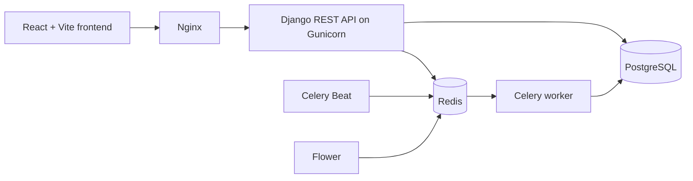

# SneakIn

A full-stack sneaker e-commerce platform built with Django REST Framework and React.

[](https://github.com/muhammedsiinanmp/Sneak-in-ecommerce/actions/workflows/ci.yml)

**Frontend:** [sneak-in-ecommerce.vercel.app](https://sneak-in-ecommerce.vercel.app)

---

## What it is

SneakIn lets customers browse a sneaker catalog, manage a cart and wishlist, place orders, and track order status. Admins get a dashboard to manage inventory, handle orders, and receive automated daily sales reports.

---

## Architecture



---

## Tech stack

| Layer | Technology |
|-------|-----------|
| Backend | Django 5.1 + Django REST Framework |
| Frontend | React 19 + Vite + TailwindCSS |
| Database | PostgreSQL 16 (AWS RDS in production) |
| Cache / Queue | Redis 7 |
| Background tasks | Celery + Celery Beat |
| Auth | JWT via SimpleJWT (token rotation + blacklisting) |
| Containerization | Docker + Docker Compose |
| Hosting | AWS EC2 t3.micro + Vercel |
| CI/CD | GitHub Actions |

---

## Features

**Customer**
- Browse products with filtering by brand, category, price
- Persistent cart and wishlist across sessions
- Order placement with price snapshot (price locked at purchase time)
- Order history and status tracking
- JWT authentication with silent token refresh

**Admin**
- Product, inventory, and brand management
- Order status management (confirm, ship, deliver, cancel)
- User management and role control
- Daily sales report auto-generated and emailed at 12:30 AM via Celery Beat

---

## Running locally

**Prerequisites:** Docker Desktop, Git, Node.js 20+
```bash
# Clone
git clone https://github.com/muhammedsiinanmp/Sneak-in-ecommerce.git
cd Sneak-in-ecommerce

# Environment
cp .env.example .env

# Create dev override file
cp docker-compose.override.example.yml docker-compose.override.yml

# Start everything
docker compose up --build

# In a new terminal — run migrations and create admin
docker compose exec backend python manage.py migrate
docker compose exec backend python manage.py createsuperuser
```

| Service | URL |
|---------|-----|
| Frontend | http://localhost:5173 |
| API | http://localhost:8000/api/ |
| API Docs (Swagger) | http://localhost:8000/api/docs/ |
| Admin panel | http://localhost:8000/admin/ |
| Celery monitor | http://localhost:5555 |

---

## Project structure
```
Sneak-in-ecommerce/
├── backend/
│   ├── apps/
│   │   ├── accounts/        # Auth, user profiles
│   │   ├── products/        # Catalog, brands, categories, sizes
│   │   ├── cart/            # Shopping cart
│   │   ├── orders/          # Order placement and tracking
│   │   ├── wishlist/        # Saved products
│   │   └── notifications/   # In-app alerts
│   ├── config/
│   │   └── settings/        # base.py / dev.py / prod.py
│   └── Dockerfile
├── e-commerce-app/          # React + Vite frontend
├── nginx/                   # Container Nginx config
├── docker-compose.yml       # Base config
├── docker-compose.prod.yml  # Production overrides
└── docker-compose.override.example.yml  # Dev template
```

---

## API reference

Full interactive docs at `/api/docs/`. Key endpoints:
```
POST   /api/auth/register/            Register
POST   /api/auth/login/               Login → JWT tokens
POST   /api/auth/token/refresh/       Refresh access token

GET    /api/products/                 List products (filterable)
GET    /api/products/{id}/            Product detail

GET    /api/cart/                     View cart
POST   /api/cart/add/                 Add item
DELETE /api/cart/item/{id}/remove/    Remove item

POST   /api/orders/place/             Place order
GET    /api/orders/                   Order history

GET    /api/health/                   Service health check
```

---

## Running tests
```bash
docker compose exec backend pytest
```

---

## Deployment

Production runs on AWS EC2 with Docker Compose. Deployment is automated via GitHub Actions — push to `main` and the CD pipeline SSHs into EC2, pulls the latest code, rebuilds containers, runs migrations, and health-checks the API.
```bash
# Manual deploy (if needed)
ssh -i your-key.pem ubuntu@<your-ec2-host>
cd ~/Sneak-in-ecommerce
git pull origin main
docker compose -f docker-compose.yml -f docker-compose.prod.yml up -d --build
```

---

## Environment variables

Copy `.env.example` and fill in values. Key variables:
```bash
SECRET_KEY=
DJANGO_SETTINGS_MODULE=config.settings.dev

DB_NAME=sneakin_db
DB_USER=postgres
DB_PASSWORD=postgres
DB_HOST=db

CELERY_BROKER_URL=redis://redis:6379/1
CELERY_RESULT_BACKEND=redis://redis:6379/2

EMAIL_HOST_USER=
EMAIL_HOST_PASSWORD=
```

---

## License

[MIT](License)